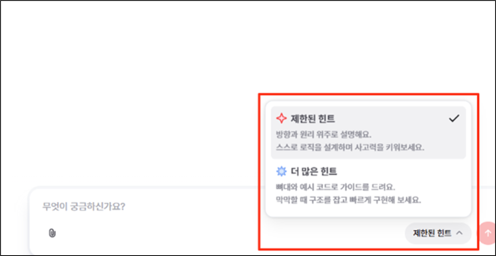
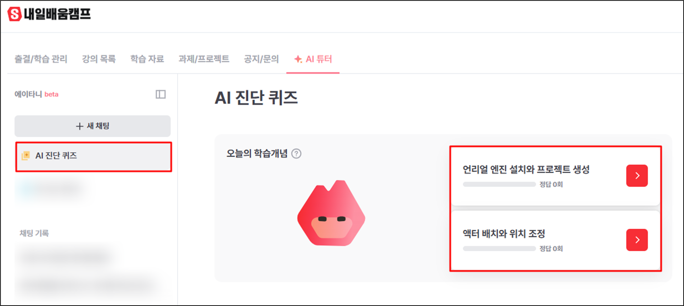

# AI 튜터 에이타니 활용 가이드 (1)

- 문서 ID: NOTION-006
- 분류: 필독
- Notion 원문: https://app.notion.com/p/4216d0d25caa80f99c38d0b1b29f119b
- 수집일: 2026-11-23
- Notion 최종 수정 시각: 2026-11-23T01:55:29.101Z

<table-of-contents color="gray" />

---

### 1\. 에이타니가 다른 AI와 다른 이유

AI를 써본 분들이라면 이런 경험 한 번은 해보셨을 거예요.

- 커리큘럼과 전혀 다른 방향을 알려줘서 오히려 더 헷갈릴 때
- 아직 안 배운 개념이 답변에 나와 그대로 따라하기 어려울 때
- 질문 하나 하려고 상황 설명에만 한참이 걸릴 때

에이타니는 여러분들의 시간표와 커리큘럼, 현재 학습하고 있는 내용을 정확하게 알고 있어요.  자세한 배경 설명 없이 질문해도 지금 여러분 상황에 딱 맞는 답변을 받을 수 있어요.

---

### 2\. 에이타니는 AI 튜터입니다

<callout icon="💡">
답을 대신 만들어주는 게 아니라, 여러분이 직접 이해하고 풀 수 있도록 도와드려요.

AI한테 학습을 대신 하도록 맡기는 게 아니니까 죄책감 없이, 

마음껏 활용하셔도 돼요.
</callout>

---

### 3\. 이렇게 활용해보세요

### ① 과제 / 프로젝트가 막막할 때

→ 방향이 안 잡힌다, 구현 방법을 모르겠다 싶으면 지금 상황을 그대로 이야기해 보세요. 상황에 맞는 맞춤 도움을 받을 수 있어요.

### ② 대화 모드 활용하기

→ "제한된 힌트, 더 많은 힌트" 설정을 통해 원하는 수준을 직접 요청할 수 있어요. 개념 이해를 위해서는 생황 예시가 있는 제한된 힌트부터, 시작조차 어려울 땐 더 구체적인 힌트까지 조절할 수 있어요.

### ③ 이해도 확인하고 싶을 때

→ "내가 이렇게 이해했는데, 잘 이해한 거 맞아?" 하고 에이타니에게 설명해 보세요. 대화를 통해 진짜 이해했는지 확인해드려요.

---

### 4\. \`AI 진단 퀴즈\` 로 내 이해도를 검증해보세요

에이타니와 질의응답으로 개념을 이해했다면, 이제 직접 검증해 볼 차례예요.

AI 진단 퀴즈는 시간표에 맞게 구성되어 있어요. 퀴즈를 잘 푼다면, 이론을 잘 이해했다고 볼 수 있어요.

퀴즈를 풀다가 막히는 문제가 생기면, 바로 에이타니에게 질문할 수도 있답니다.  

<callout icon="💡">
<b>추천 학습 흐름</b>

강의 수강 → 모르는 개념 에이타니에게 질문 → AI 진단 퀴즈로 이해도 검증 → 틀린 부분 다시 에이타니에게 질문하여 정확하게 이해하기
</callout>

---

### 5\. 에이타니로 이런 역량도 함께 키워요

<table header-row="true">
<colgroup>
<col width="169.00000762939453" />
<col width="752.0000152587891" />
</colgroup>
<tr>
<td>
역량
</td>
<td>
설명
</td>
</tr>
<tr>
<td>
🧠 메타인지 향상
</td>
<td>
질문을 정리하는 과정에서 내가 무엇을 모르는지 스스로 파악하게 돼요. 학습 효율의 핵심 요인입니다.
</td>
</tr>
<tr>
<td>
🛠️ 자기해결 능력
</td>
<td>
문제를 스스로 정의하고 AI로 답을 탐색하는 경험이 쌓이면 든든한 문제 해결 능력이 생겨요.
</td>
</tr>
<tr>
<td>
💬 튜터님과 더 깊은 대화
</td>
<td>
에이타니로 기본 개념을 먼저 다지고 튜터님을 만나면, 더 핵심적인 질문을 할 수 있어요.
</td>
</tr>
<tr>
<td></td>
<td></td>
</tr>
</table>

### ※ 실제 수강생 후기

<quote>
🙋 "물어보기 애매한 질문도 이해할 때까지 계속 물어볼 수 있었어요. 구글링 시간도 확 줄었어요."

🙋‍♀️"강의 맥락에 딱 맞는 답변을 받을 수 있었어 빠르게 학습을 이어갈 수 있었어요."

🙋‍♂️"다른 AI 를 활용할 때, 커리큘럼과 학습 방향 등이 달라서 오히려 헷갈렸는데, 에이타니는 지금 배우는 내용 기준으로 정확하게 알려줘요."
</quote>

---

<callout icon="🚀">
지금 바로 에이타니에게 질문해보세요!

👉 <b>에이타니 바로가기: </b> [https://nbcamp.spartaclub.kr/lms/ai-tutor](https://nbcamp.spartaclub.kr/lms/ai-tutor)
</callout>
