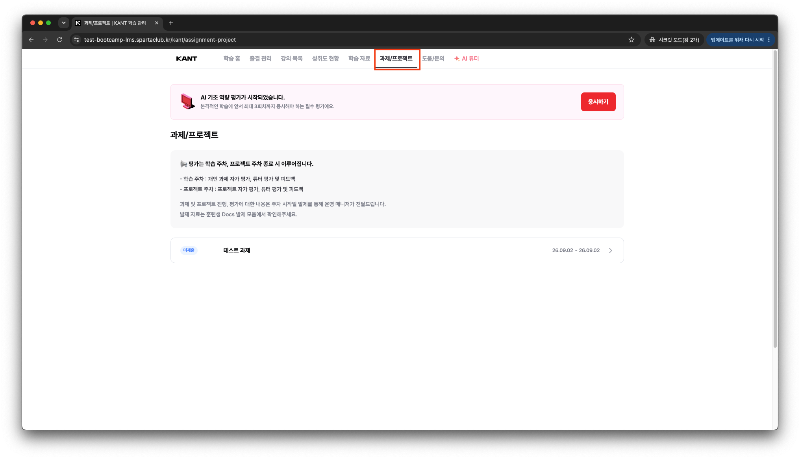
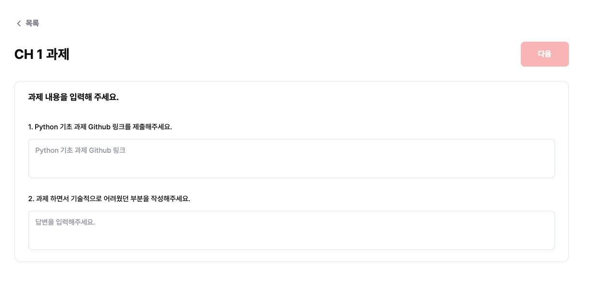
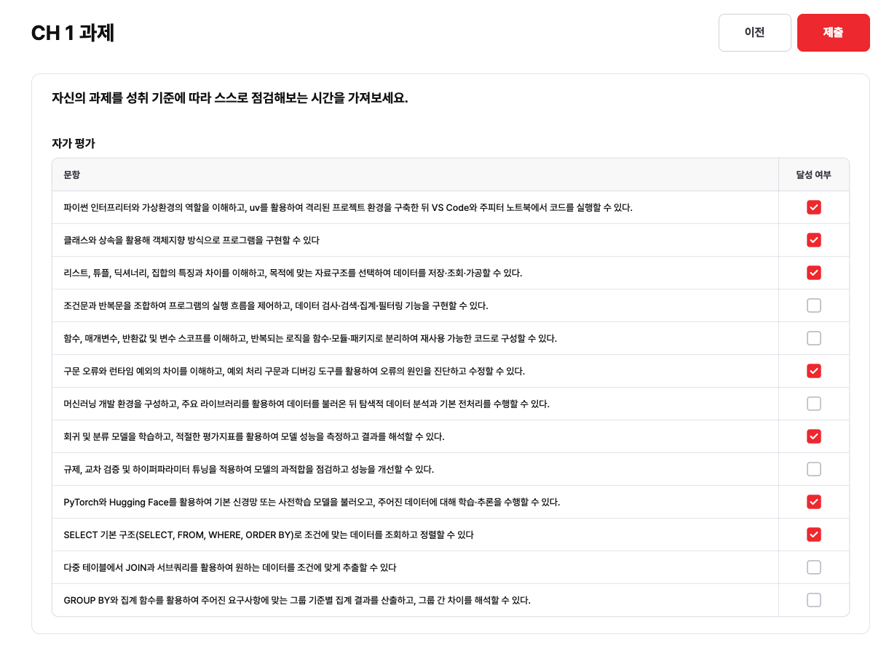

# 📖 [KANT] 과제 제출 가이드 (1)

- 문서 ID: NOTION-009
- 분류: 필독
- Notion 원문: https://app.notion.com/p/4216d0d25caa80be9c29c4f1dc6a203c
- 수집일: 2026-11-23
- Notion 최종 수정 시각: 2026-11-23T01:55:29.101Z

<callout icon="📌">
## 과제 제출 링크

- [bootcamp-lms.spartaclub.kr](https://bootcamp-lms.spartaclub.kr/kant) 접속
- 로그인 > 상단 메뉴바 > 과제/프로젝트 탭으로 이동
  
</callout>

## 과제 제출 방법

<b>1️⃣ </b>제출 링크에서 제출할 과제명/기간을 확인하고 클릭합니다.

<b>2️⃣ </b>첫 페이지 : 최종 결과물 제출과 과제를 진행하며 어려웠던 점을 작성해주세요.

<b> 3️⃣ </b>두 번째 페이지 : 자신의 과제를 피드백 기준 체크리스트에 체크하며 점검해보는 시간을 가져보세요.

<callout icon="📌">
<ul>
<li>
체크리스트는 성취도 평가 문항 중 ‘구현’ 영역에 해당하는 항목으로 구성되어 있습니다. 
</li>
<li>
각 문항을 충분히 읽고, 자신의 과제가 해당 기준을 충족했는지 꼼꼼히 확인해 주세요. 
</li>
<li>
체크가 정확하고 디테일 할수록 좋습니다. 충분히 생각하는 시간을 가지고 체크해주세요.
</li>
</ul>
</callout>

---

<callout icon="notion://custom_emoji/83c75a39-3aba-4ba4-a792-7aefe4b07895/2e82dc3e-f514-806d-87fb-007a9ed5792a" color="gray_bg">
<b>Q. </b><b>과제를 미완성 또는 진행하지 않았어요.</b>

A. 완성 / 미완성 / 진행하지 않음 중 하나로 표기해주세요!
</callout>

<callout icon="notion://custom_emoji/83c75a39-3aba-4ba4-a792-7aefe4b07895/2e82dc3e-f514-806d-87fb-007a9ed5792a" color="gray_bg">
<b>Q. 과제가 아직 완료되지 않았어요. 어떡하죠?</b>

A. 정해진 기한 내에서 수행 정도를 파악해야 한 분 한 분께 맞는 피드백을 전달드릴 수 있습니다. 진행한 부분까지라도 무조건 제출해주세요!
</callout>
