# [KANT] 출석 및 공가 신청 가이드

- 문서 ID: NOTION-014
- Notion 원문: https://app.notion.com/p/4216d0d25caa804c9992d2b43ac83e2a
- 수집일: 2026-11-23
- Notion 최종 수정 시각: 2026-11-23T01:59:49.658Z

<b>✅ 핵심 요약</b>

- 유의사항: 하루의 수업시간 50% 미만 수강 시, 결석 처리
- 출석 가능 시간
  - 입실: \~09:10
  - 09:10 이후 입실 시, <code>지각</code>
  - 퇴실: 17:50\~23:59
    - 17:50 이전 퇴실 시, <code>조퇴</code>
    - 당일 자정 전(23:39)까지 퇴실 미체크 시, <code>결석</code>

<h2 color="yellow_bg">
공가 신청
</h2>

<b><code>공가</code></b> 인정되는 공적인 사유로 결석하게 될 때 신청하는 휴가를 의미해요. 사유에 따라 올바른 증빙자료를 제출하면 해당 일 전체가 출석으로 인정됩니다.

<b><code>출석정정</code></b> 공적인 사유는 아니지만, 각종 사정으로 출석체크를 정상적으로 하지 못했을 때 출석 상태를 정정하는 것을 의미해요. 사유에 따라 당일의 학습기록(젭, 줌 접속로그 등)이 추가로 필요한데요, 이때는 실제 학습기록을 기준으로 출석, 지각, 조퇴 등 다양하게 처리될 수 있습니다.

## 전체 인정 사유 및 필요 증빙자료

---

고용노동부에서 지정한 공식 사유 및 증빙자료 조건입니다. 토글을 열면 모든 사유를 확인할 수 있어요!

<toggle>
⭕️ 공가 및 출석정정 인정 사유

훈련생이 결석한 사유가 아래 기준에 부합하고, 적합한 증빙서류를 제출했다면 공가로 인정될 수 있어요.

<table header-row="true">
<colgroup>
<col width="227.125" />
<col width="182.47918701171875" />
<col width="296.45833587646484" />
<col width="839.7708435058594" />
</colgroup>
<tr color="gray_bg">
<td>
<b>공가 인정 사유</b>
</td>
<td>
<b>출석인정일수</b>
</td>
<td>
<b>필요 서류</b>
</td>
<td>
<b>참고</b>
</td>
</tr>
<tr>
<td>
질병/입원(본인, 자녀)
</td>
<td>
전체 소정훈련일수의 10 퍼센트(소수점 이하 첫째자리에서 반올림하여 계산)
</td>
<td>
병명 혹은 질병코드 명시된 <b>진료 확인서, 진료비내역서 혹은 진단서, 처방전 등</b> (자녀)가족관계증명서
</td>
<td>
- <b>반드시 증빙서류에 병명 혹은 질병코드가 명시</b>되어 있어야 함. - 공가신청일과 동일한 <b>방문 날짜</b>가 명시되어 있어야함 - 일반 건강검진, 라식수술 인정 불가 - 진단서나 소견서 내 기재된 <b>진료일만</b> 인정 가능 -난임치료 공가 인정
</td>
</tr>
<tr>
<td>
취업, 훈련 관련 시험 (자격증, 면허증 등)
</td>
<td>
소요일수
</td>
<td>
응시확인서
</td>
<td>
- 접수확인서 불가 - 훈련과정과 관련된 자격시험만 가능(예. 정보처리기사 등) - 대학교 중간 및 기말고사 인정 불가
</td>
</tr>
<tr>
<td>
입사시험(면접)
</td>
<td>
소요일수
</td>
<td>
기업 직인이 포함된 면접확인서 or 담당자나 대표의 싸인이 포함된 면접확인서 + 담당자나 대표의 명함
</td>
<td>
- 서류 합격 안내문, 면접 통지서 불가 - 면접확인서 내 <b>기업의 직인이 포함</b>되어 있어야 함.(싸인 단독 인정 불가) -기업 직인이 없을 경우, 일정을 조율한 <b>메일 혹은 문자를 같이</b> 첨부 - <b>싸인만 있는 경우, 담당자나 대표의 명함까지 </b>함께 첨부 필요 - 동일 기업에 중복 공가 처리 불가
</td>
</tr>
<tr>
<td>
선거권, 기타 공민권 행사
</td>
<td>
소요일수
</td>
<td>
투표확인증
</td>
<td></td>
</tr>
<tr>
<td>
예비군, 민방위 훈련
</td>
<td>
소요일수
</td>
<td>
교육필증
</td>
<td>
- 소집통지서 불가 - 연속 사유발생시, 모든 훈련일수마다 개별로 신청 필요
</td>
</tr>
<tr>
<td>
징병검사
</td>
<td>
소요일수
</td>
<td>
참여확인서
</td>
<td></td>
</tr>
<tr>
<td>
결혼(본인, 자녀)
</td>
<td>
5일 / 1일
</td>
<td>
청첩장, 가족관계증명서
</td>
<td>
- 결혼일만 신청하면 됨. - (본인) 자동으로 5일 신청
</td>
</tr>
<tr>
<td>
사망(배우자, 본인 및 배우자의 부모)
</td>
<td>
토요일 및 공휴일 제외 5일
</td>
<td>
사망진단서, 가족관계증명서
</td>
<td>
- 사망일만 신청하면 됨. - 자동으로 5일 신청
</td>
</tr>
<tr>
<td>
사망(본인 및 배우자의 조부모)
</td>
<td>
토요일 및 공휴일 제외 3일
</td>
<td>
사망진단서, 가족관계증명서
</td>
<td>
- 사망일만 신청하면 됨. - 자동으로 3일 신청
</td>
</tr>
<tr>
<td>
사망(자녀, 그 자녀의 배우자)
</td>
<td>
토요일 및 공휴일 제외 3일
</td>
<td>
사망진단서, 가족관계증명서
</td>
<td>
- 사망일만 신청하면 됨. - 자동으로 3일 신청
</td>
</tr>
<tr>
<td>
사망(본인 및 배우자의 형제자매)
</td>
<td>
토요일 및 공휴일 제외 3일
</td>
<td>
사망진단서, 가족관계증명서
</td>
<td></td>
</tr>
<tr>
<td>
배우자의 출산
</td>
<td>
5일
</td>
<td>
출생증명서, 가족관계증명서
</td>
<td>
- 출산일만 신청하면 됨. - 자동으로 5일 신청
</td>
</tr>
<tr>
<td>
훈련직종 관련 해커톤, 경진대회 등
</td>
<td>
소요일수
</td>
<td>
참여확인서
</td>
<td>
- <b>고용노동부 본부에서 지정</b>한 해커톤 및 경진대회 한정 - 해당 사유로 신청하기 전에 행정 문의를 통해 확인 요망
</td>
</tr>
<tr>
<td>
국내기능경기대회, 국제기능올림픽대회 출전
</td>
<td>
소요일수
</td>
<td>
참여확인서
</td>
<td></td>
</tr>
<tr>
<td>
스마트폰 분실/고장
</td>
<td>
소요일수
</td>
<td>
- 수리 접수증, 분실 신고증 등 - 젭 접속로그
</td>
<td>
<b>- 실제 학습한 기록(젭 접속로그)가 있어야만 인정 가능</b>
</td>
</tr>
</table>
</toggle>

<toggle>
❌ 인정 불가 사유

아래 사유들은 공가로 인정될 수 없어요.

- 고용센터 방문(국취제, 실업급여 상담 등)
- 부모님의 병원 동행
- 진료 목적이 아닌 병원 검사, 검진(혈액검사, CT촬영 등)
- 라식 수술
- 질병외의 병원 방문(치과교정, 피부과, 성형외과 등)
- 단순 휴식(병원 미방문)
- 컨퍼런스 참여
- 대학교 졸업식
- 대학교 시험
- 훈련과정과 관련 없는 시험
- 노트북 분실 및 고장
- 제사
- 직계가족 외 사망(큰아버지, 사촌 등)
- 법원 출석
- 경찰서 방문
- 개인의 인터넷 환경 장애
</toggle>

## 대표 사유 별 인정 기준 및 증빙자료 예시

---

## 공가

고용노동부에서 공식적으로 인정하는 공가 사유로서, 해당 일 전체가 출석으로 인정됩니다.

<h3 color="brown_bg">
 본인 및 자녀의 질병/입원
</h3>

✅ 출석인정일수: 소요일수

- 전체 소정훈련일수의 <b>10 퍼센트</b>(소수점 이하 첫째자리에서 반올림하여 계산)

🔵 본인이 아파서 혹은 다쳐서 병원 진료(치료, 검사 등)를 받은 경우

→ 병명 혹은 질병코드가 쓰여있는 진료확인서(+진단서, 소견서, 처방전 등)

<columns>
<column ratio="43.75">
<toggle>
올바른 증빙자료

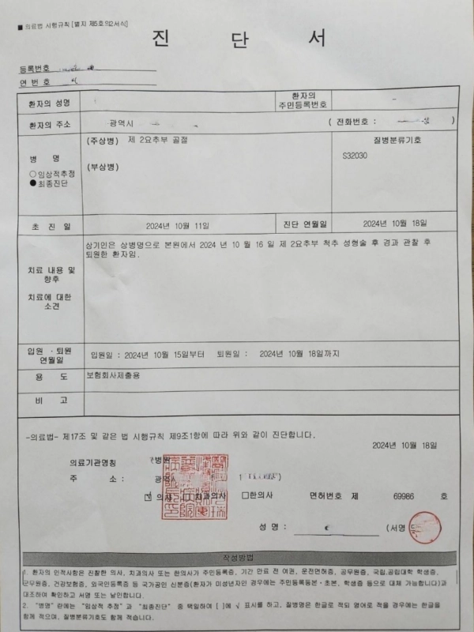

- 질병코드 있는 처방전
  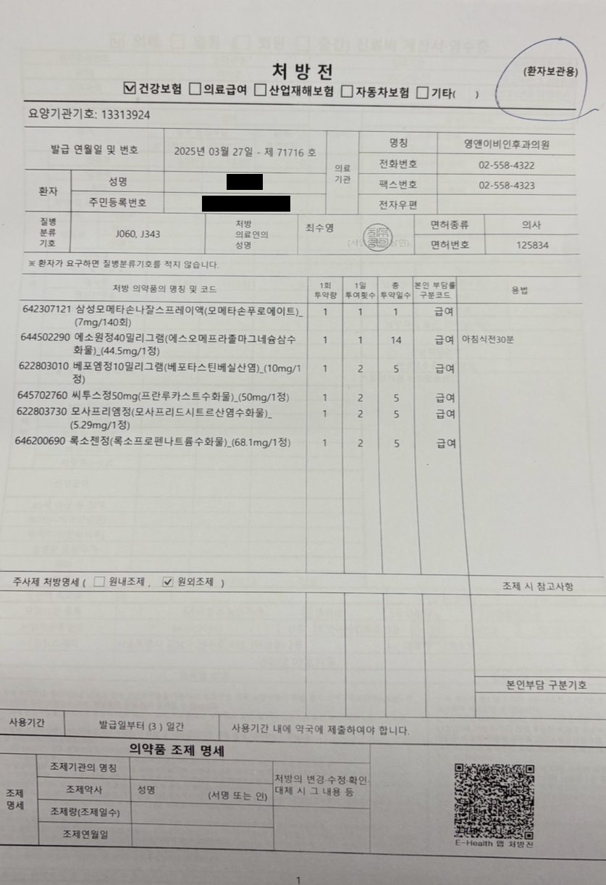
</toggle>
</column>
<column ratio="81.25">
<toggle>
잘못된 증빙자료

- <b>병명 혹은 질병코드가 쓰여있지 않은</b> 진료비계산서, 영수증, 진료비 세부산정내역서
- 병명 혹은 질병코드가 쓰여있지 않은 진료확인서
  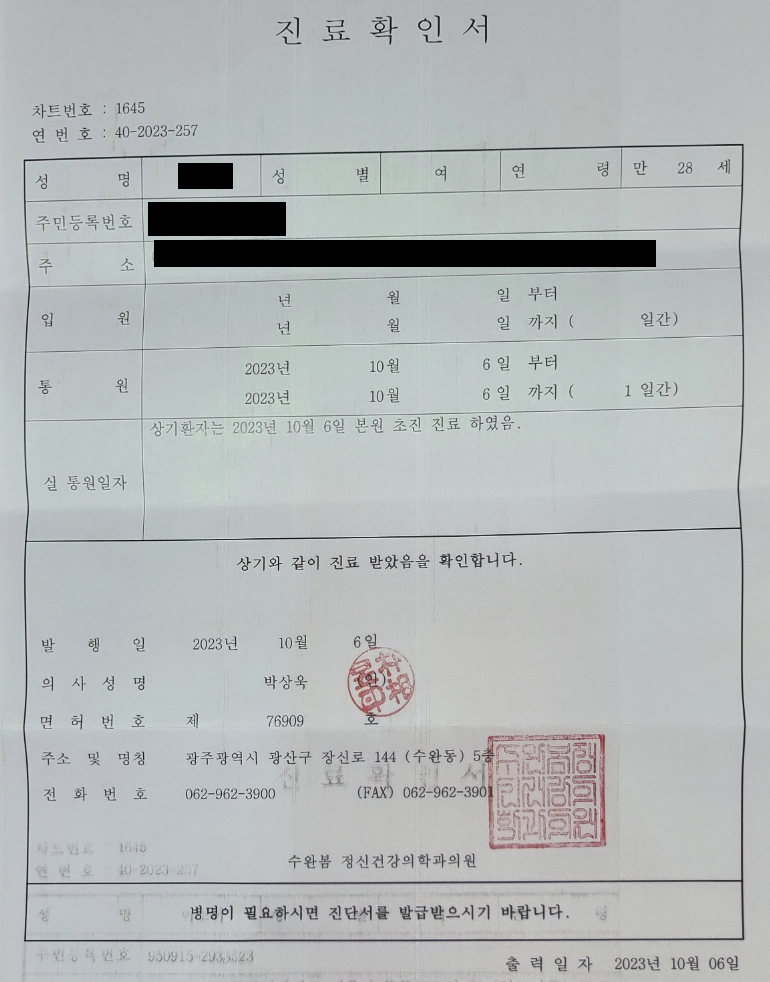
</toggle>

</column>
</columns>

🔵 본인이 아파서 혹은 다쳐서 여러 날 입원한 경우

→ 입퇴원 기간이 쓰여있는 입퇴원확인서

<toggle>
올바른 증빙자료

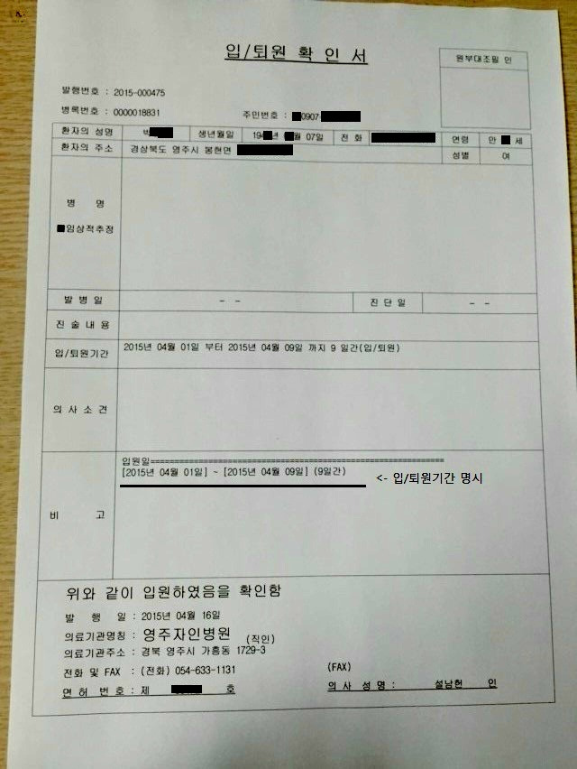
</toggle>

🔵 만 19세 미만 자녀의 병원 진료/입원에 동반한 경우

→ 상기 조건과 동일한 진단서(병원 진료) or 입퇴원확인서(입원) + 가족관계증명서

<toggle>
올바른 증빙자료

- 2가지 서류 구비 필요

<columns>
<column ratio="43.75">
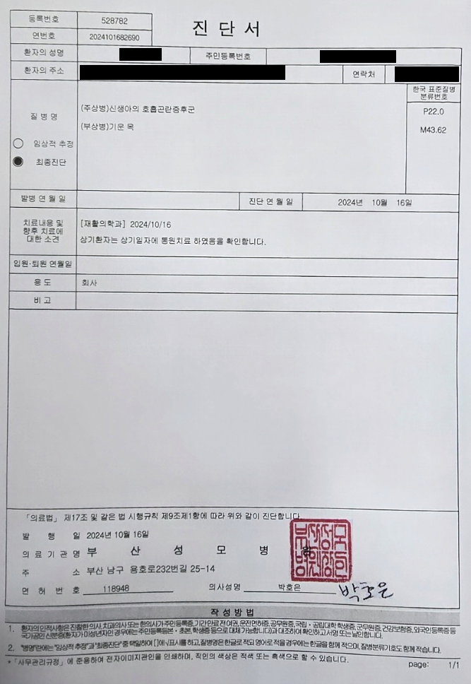
</column>
<column ratio="56.25">

</column>
</columns>
</toggle>

<b>❌ </b>일반 건강검진(예방접종)

<b>❌ </b>미용 목적의 병원 방문(라식, 라섹, 기타 성형 수술 및 시술)

<b>❌ </b>부모님, 조부모님의 병원 동행

<b>❌ </b>병원에 방문하지 않고 집에서 약 먹고 휴식

<h3 color="brown_bg">
 입사시험(면접)
</h3>

✅ 출석인정일수: 소요일수

🔵 취업을 위해 기업의 채용전형 중 면접에 참여한 경우

→ 면접확인서

<columns>
<column ratio="43.75">
<toggle>
올바른 증빙자료

기업 직인 포함

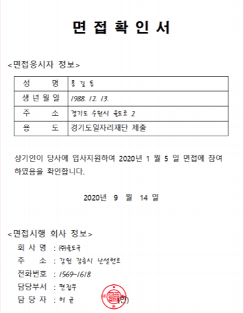
</toggle>

</column>
<column ratio="87.5">
<toggle>
잘못된 증빙자료

- 직인이 아니라, 싸인이 포함된 서류 (담당자/대표의 명함이 추가로 준비되면 인정 가능)
  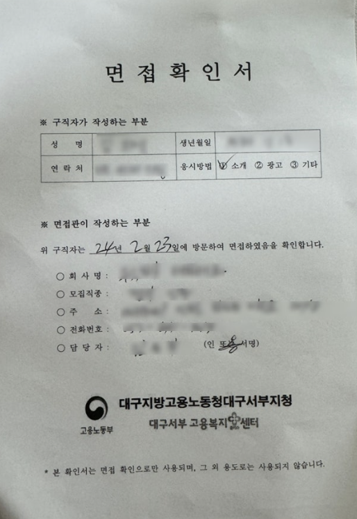
- (단독) 서류 합격 통지 및 면접 안내문(메일, 문자 등)
  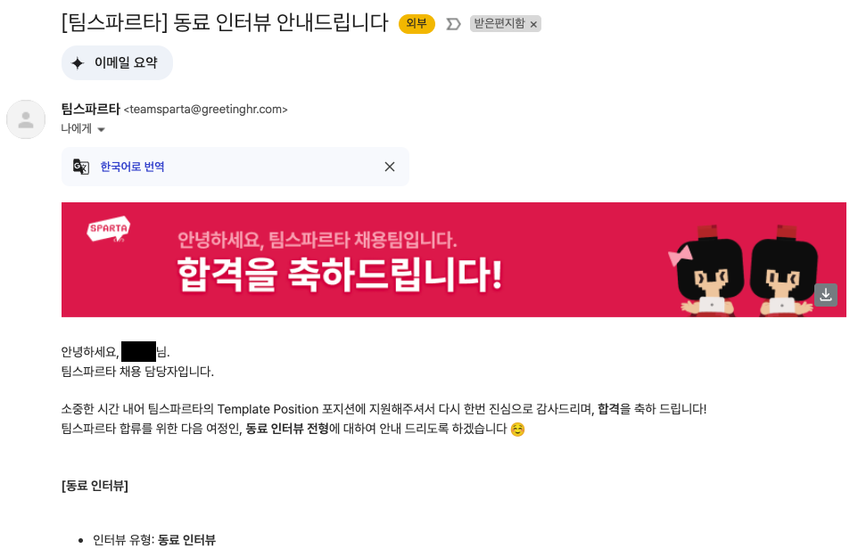

  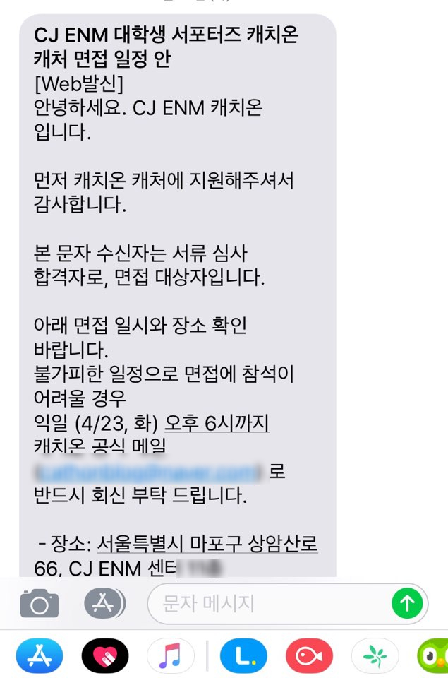
</toggle>
</column>
</columns>

<b>❌ </b>채용 담당자와의 티타임, 커피챗

<h3 color="brown_bg">
 취업, 훈련 관련 시험
</h3>

✅ 출석인정일수: 소요일수

🔵 훈련과정과 관련된 자격증 / 면허증 취득을 위한 시험에 응시한 경우

→ 응시확인서

<columns>
<column ratio="50">
<toggle>
올바른 증빙자료

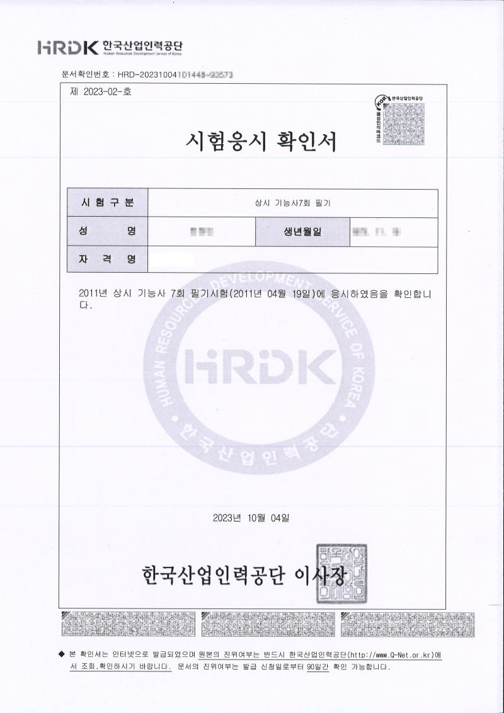
</toggle>
</column>
<column ratio="83.33">
<toggle>
잘못된 증빙자료

- 접수 확인서
  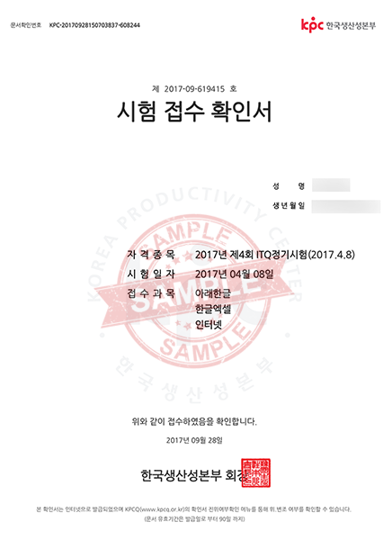
</toggle>
</column>
<column ratio="4.17"></column>
</columns>

🔵 취업을 위해 기업의 채용전형 중 필기 시험(코딩테스트 등)에 참여한 경우

→ 응시확인서

<columns>
<column ratio="43.75">
<toggle>
올바른 증빙자료

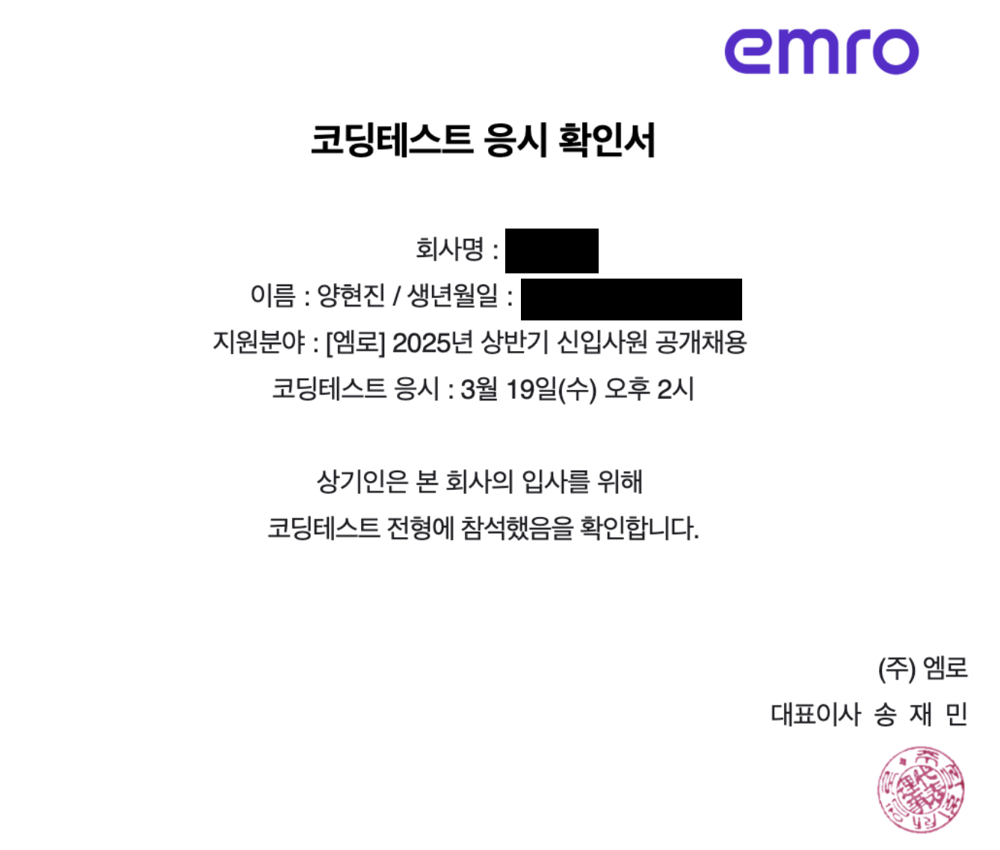

</toggle>
</column>
<column ratio="87.5">
<toggle>
잘못된 증빙자료

- 시험 응시 안내문

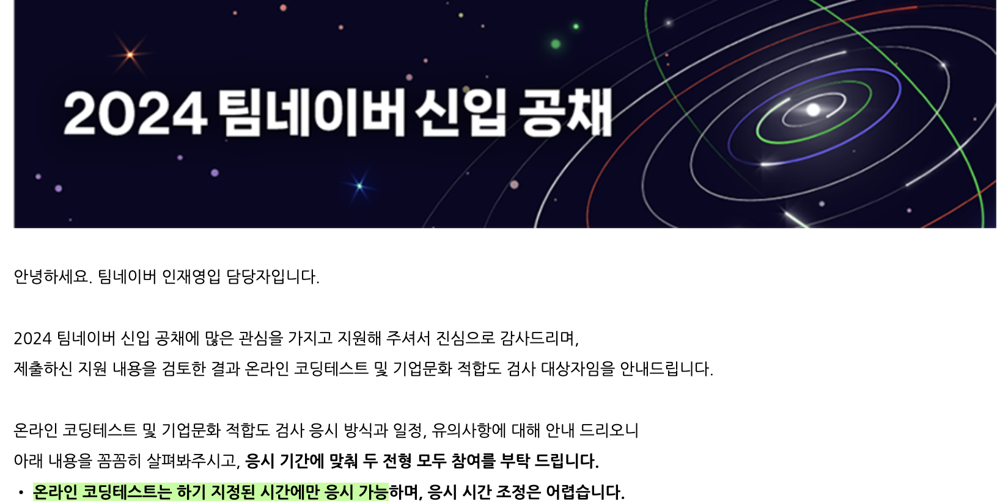

- 시험 응시 안내 메일

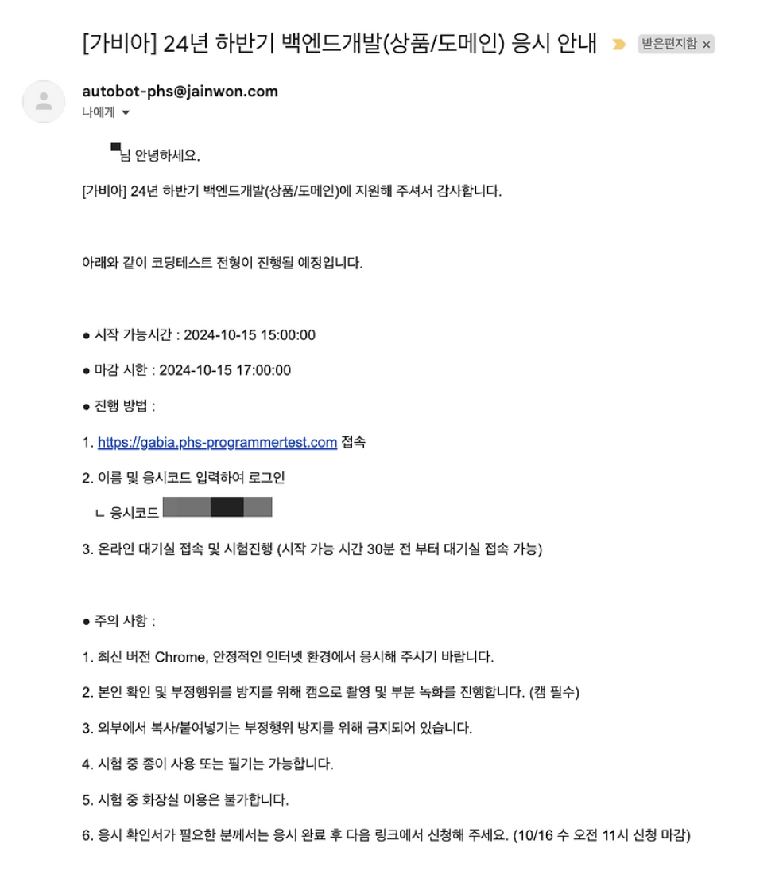

- 서류 전형 합격 및 시험 안내문
  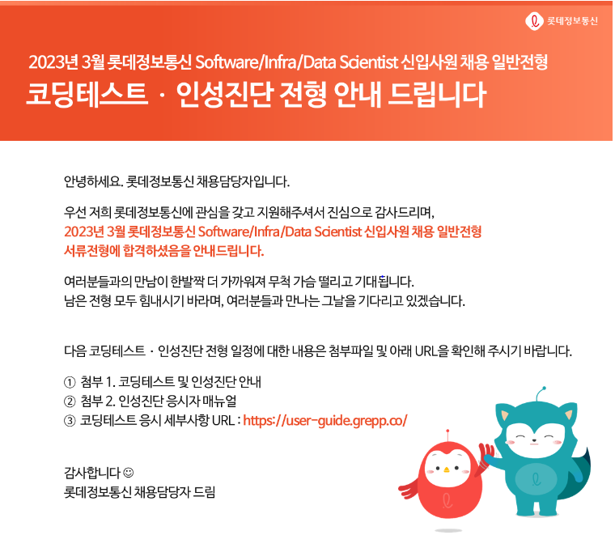
</toggle>
</column>
</columns>

❌ 수강 중인 훈련과정과 무관한 자격증 취득을 위한 시험에 응시한 경우(토익, JLPT 등)

❌ 대학교 중간고사, 기말고사

<h3 color="brown_bg">
 직계가족의 사망
</h3>

✅ 출석인정일수 - <b>사망일만 신청</b>하면 나머지 일수는 자동 신청

<table header-row="true">
<colgroup>
<col />
<col width="194.78550720214844" />
</colgroup>
<tr>
<td>
<b>직계가족의 사망</b>
</td>
<td>
<b>출석인정일수</b>
</td>
</tr>
<tr>
<td>
사망(배우자, 본인 및 배우자의 부모)
</td>
<td>
토요일 및 공휴일 제외 5일
</td>
</tr>
<tr>
<td>
사망(본인 및 배우자의 조부모)
</td>
<td>
토요일 및 공휴일 제외 3일
</td>
</tr>
<tr>
<td>
사망(자녀, 그 자녀의 배우자)
</td>
<td>
토요일 및 공휴일 제외 3일
</td>
</tr>
<tr>
<td>
사망(본인 및 배우자의 형제자매)
</td>
<td>
토요일 및 공휴일 제외 3일
</td>
</tr>
</table>

🔵 배우자 / 본인 혹은 배우자의 부모, 조부모, 자녀, 형제자매의 사망

→ 사망진단서 + 가족관계증명서

<toggle>
올바른 증빙자료

- 2가지 서류 구비 필요

<columns>
<column ratio="31.25">
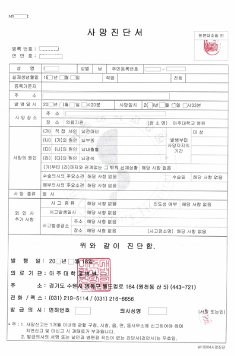
</column>
<column ratio="68.75">
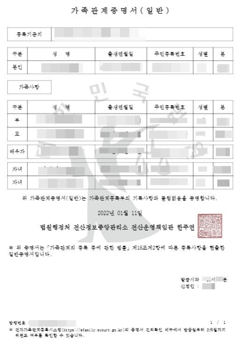
</column>
</columns>
</toggle>

<b>❌ </b>삼촌, 이모, 지인 등 직계가족이 아닌 사람의 사망

<b>❌ </b>집안 제사

<h3 color="brown_bg">
 예비군, 민방위 훈련
</h3>

✅ 출석인정일수: 소요 일수 - <b>모든 훈련일 개별 신청 필요</b>

🔵 소집 통지에 따라 예비군, 민방위 훈련에 참여한 경우

→ 훈련필증

<columns>
<column ratio="56.25">
<toggle>
올바른 증빙자료

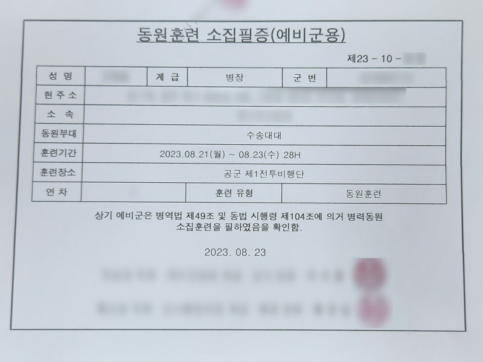
</toggle>

</column>
<column ratio="100">
<toggle>
잘못된 증빙자료

- 소집통지서

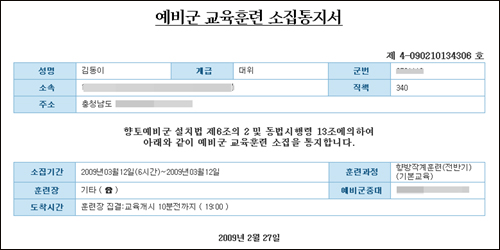
</toggle>
</column>
</columns>

---

## 출석입력요청

아래 사유(스마트폰 분실/고장, 시스템장애)는 출석만 불가할 뿐 학습은 가능하기 때문에, <b>출석 기록</b><b>이 추가 증빙자료로 필요합니다. 사유발생 즉시</b> 구비하여 행정 매니저님께 전달합니다.

<h3 color="brown_bg">
 스마트폰 분실/고장
</h3>

✅ 출석인정일수: 소요일수

🔵 본인인증 및 입퇴실 체크에 필요한 스마트폰을 잃어버린 경우

→ 분실신고증 + 출석 기록

<toggle>
올바른 증빙자료

가입 이동통신사에 분실신고 접수 후, 고객센터 문의 필요

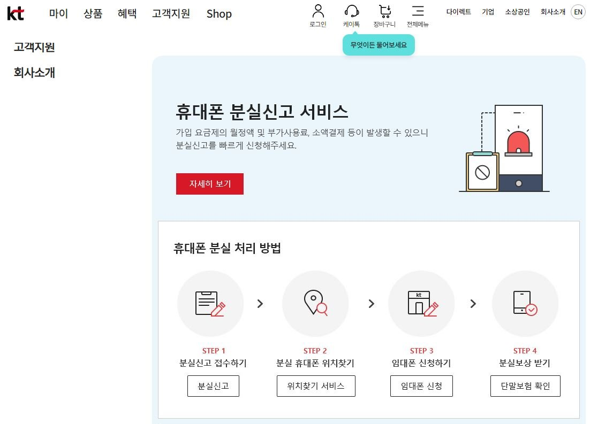

</toggle>

🔵 본인인증 및 입퇴실 체크에 필요한 스마트폰이 고장 나 사용할 수 없는 경우

→ 수리 접수증 + 출석 기록

<columns>
<column ratio="56.25">
<toggle>
올바른 증빙자료

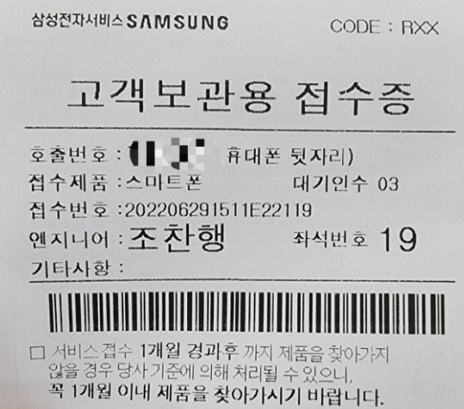
</toggle>
</column>
<column ratio="100">
<toggle>
잘못된 증빙자료

- 훼손되거나 고장 난 스마트폰 사진
  
</toggle>

</column>
</columns>

❌ 스마트폰 분실/고장에도 불구하고 신규 개통하지 않거나 수리하지 않는 경우

<h3 color="brown_bg">
 시스템 장애
</h3>

✅ 출석인정일수: 소요일수

🔵 출석체크 홈페이지 혹은 어플리케이션 오류가 발생한 경우

→ 오류 화면 녹화본 + 강의실 내/외부에서 수강생 명찰 + 핸드폰 시간 + 수강생 얼굴이 모두 나오도록 사진 촬영

<toggle>
올바른 증빙자료

<columns>
<column ratio="18.75">
[원본 첨부](./assets/notion-20261123-39.mp4)
</column>
<column ratio="81.25">
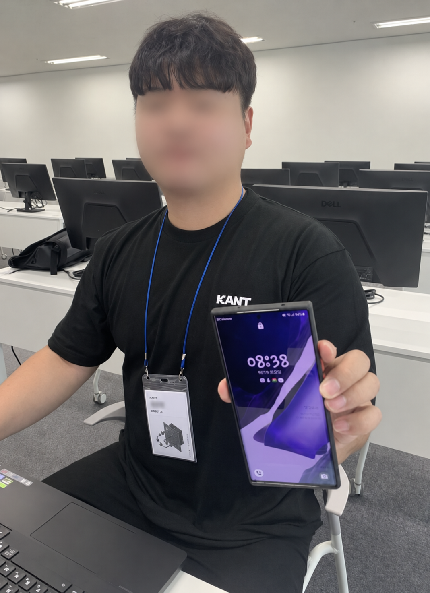
</column>
</columns>

</toggle>

❌ 개인 인터넷 환경 문제로 입퇴실 시간 내 체크를 못한 경우

### 공가 신청 방법

- KANT 출결 페이지 하단 공가 신청

1. KANT 마이페이지 > 출결/학습관리 > 하단 공가 신청 <b>(사유 발생일 다음날 17시까지 접수 가능)</b>
2. 공가 신청 접수가 확인되면, 행정 매니저가 순차적으로 연락 드립니다.
   - <b>사유 발생일 이후</b> 3일 내 연락 드립니다.
3. 팀스파르타(주)에서 발송된 메일 확인 후, ‘내용 확인하고 서명하기’ 클릭
   <toggle>
   수신 메일 화면 예시

   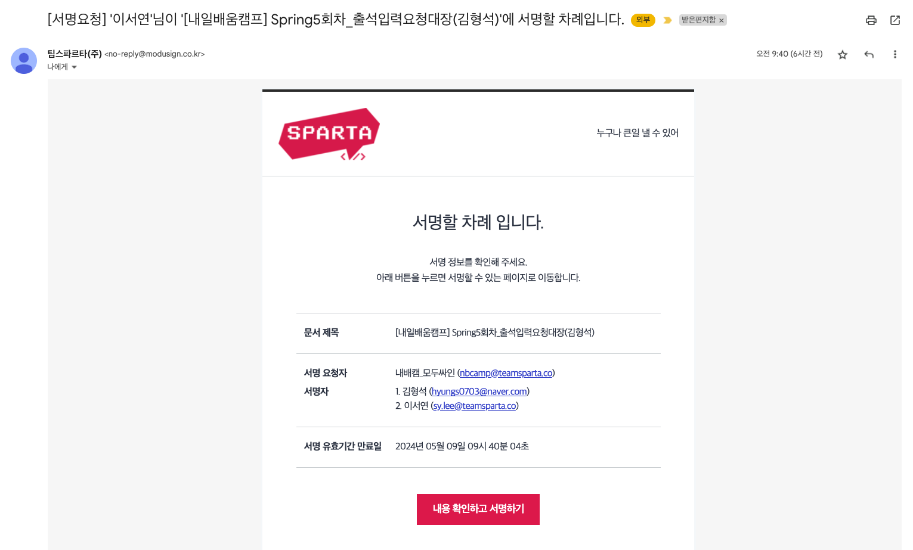
   </toggle>
4. 출석입력요청대장에 증빙자료 첨부 후 서명하여 회신 <b>(3일 이내 올바른 증빙자료 미회신 시, 접수 취소)</b>
   <toggle>
   출석입력요청대장 서류 예시

   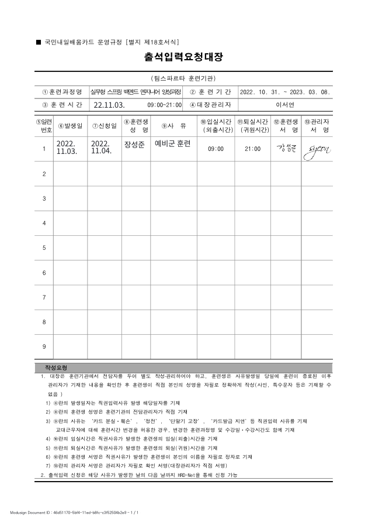
   </toggle>

   - 도장 생성하여 서명

### 🚨 공가 신청 유의 사항

- <b>사유발생일 다음날 오후 5시까지 신청</b>이 가능합니다.  (신청 방법: ‘마이페이지 > 출결/학습관리 하단에서 신청’ 제출)
  - 이후 신청 시 처리가 불가합니다.
  - 미리 신청이 가능하니, 날짜가 확정되면 미리 신청해주시는 것이 좋습니다.
- <b>행정 매니저의 DM 수신일 포함 3일 이내 출석입력요청대장 서명 및 증빙자료 제출을 하지 않을 경우, 공가 신청은 자동으로 취소됩니다.</b>
- 증빙자료가 미처 구비되어 있지 못한 상태여도 <b><code>공가 신청</code></b>을 먼저 제출해주셔야 합니다.
  - <code>공가 선 접수 → 행정 매니저 DM 수신 → 출석입력요청대장 서명 및 증빙자료 사후 제출</code>
- 증빙자료 조건 미충족 시, 공가 승인이 불가합니다.
- 예비군 훈련, 입원 등 <b>2일 이상의 공가를 신청하실 경우, 모든 날짜를 하루 단위로 각각 신청</b> 넣어주셔야 합니다. (각 날짜별로 신청 기한 적용)
  

  <b><code>참고</code></b> 직계가족 사망의 사유는 사망일만 신청해주셔도 자동으로 나머지 일수가 인정됩니다.
  

- 증빙자료 제출 후 최종 승인까지 최대 1주일 소요됩니다. (출석부 반영)
- 동일한 날짜의 공가 신청을 중복으로 접수할 시, 최신 신청만이 조회되기 때문에 누락 가능성이 커지고 처리가 더 늦어집니다.
