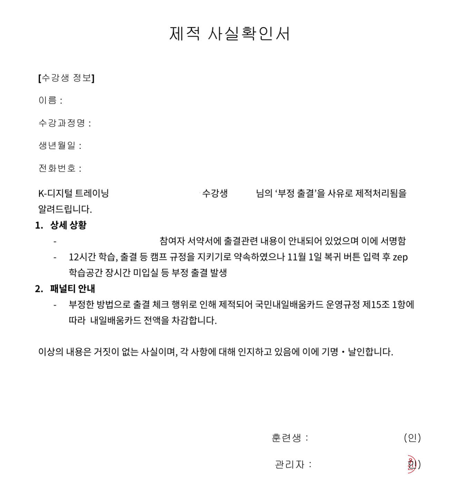
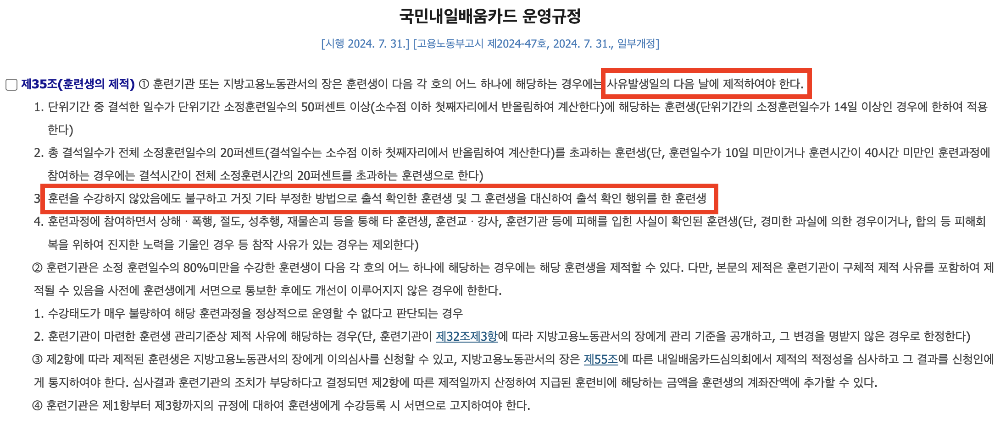
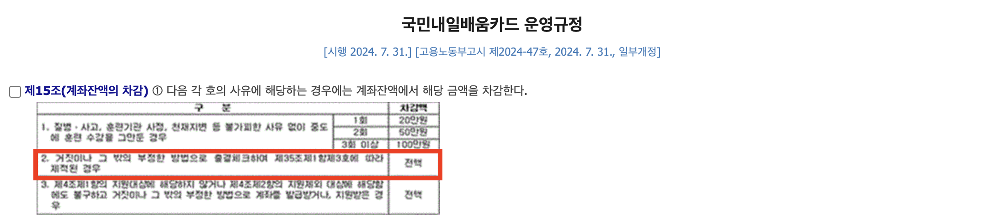

# [KANT] 부정 출결 조치 안내

- 문서 ID: NOTION-015
- Notion 원문: https://app.notion.com/p/4216d0d25caa8055821ecd338b29d56e
- 수집일: 2026-11-23
- Notion 최종 수정 시각: 2026-11-23T02:00:33.185Z

<callout icon="🚨">
### <b>부정출결이란?</b>

훈련을 수강하지 않았음에도 불구하고 거짓 기타 부정한 방법으로 출석을 확인하거나, 그 훈련생을 대신하여 출석을 확인한 행위를 말합니다.
</callout>

<callout icon="❓" color="yellow_bg">
<b>부정출결을 왜 금지하고 별도 조치를 취하나요?</b>
</callout>

- <b>면학 분위기 형성 및 협업 지원을 위해</b>
  

  KANT는 프로젝트 중심의 교육과정이며 모든 프로젝트는 팀 단위로 진행됩니다. 모든 훈련생이 성실히 학습 및 프로젝트에 참여할 수 있도록 지원함으로써 올바른 면학 분위기를 형성하고 원활한 팀 협업을 돕습니다.
  

- <b>공정성 확보</b>
  

  KANT는 고용노동부 지원 K-Digital Training 과정으로, <u>출석률에 따라 수료 가능 여부와 훈련장려금 수령 금액이 달라집니다.</u>
  

  

  부정한 방법으로 교육과정 수료 자격을 얻거나 금전을 수급하는 행위를 방지함으로써, 교육과정의 공정성을 유지하고 모든 훈련생이 올바른 자격과 절차에 따라 혜택을 받을 수 있도록 돕기 위함입니다.
  

<callout icon="🚫" color="yellow_bg">
<b>부정출결 해당 케이스</b>
</callout>

1. 정규 교육 시간 내 학습 외 다른 일을 병행하는 경우
   - 근로(재택근로 포함), 학교 수업(온라인 수업 포함) 참여, 타 훈련과정 수강 등
2. 마이페이지에 입실 체크는 했으나 강의장에 입실하지 않은 경우
3. 입실 후 훈련 중 특정 사유 없이 부재 및 운영진의 호출에 응하지 않는 경우
4. 기타 성실한 훈련 참여로 볼 수 없는 행위를 지속하는 경우

<callout icon="⛔" color="yellow_bg">
<b>부정출결 적발 시 받는 불이익</b>
</callout>

<ol>
<li>
부정출결과 제적 상황에 대한 사실확인서를 작성합니다.

<toggle>
사실확인서 예시

</toggle>
</li>
<li>
국민내일배움카드 운영규정 제35조에 따라, 훈련과정에서 제적되며, 즉시 모든 프로그램의 참여가 제한됩니다.

- <b><u>별도의 경고 절차 없이</u></b>, 부정출결 적발 즉시 제적됩니다.

<toggle>
[국민내일배움카드 운영규정 원문](https://www.law.go.kr/%ED%96%89%EC%A0%95%EA%B7%9C%EC%B9%99/%EA%B5%AD%EB%AF%BC%EB%82%B4%EC%9D%BC%EB%B0%B0%EC%9B%80%EC%B9%B4%EB%93%9C%EC%9A%B4%EC%98%81%EA%B7%9C%EC%A0%95)

</toggle>
</li>
<li>
국민내일배움카드 운영규정 제15조에 따라, 내일배움카드 잔액 전액이 차감됩니다.

<toggle>
[국민내일배움카드 운영규정 원문](https://www.law.go.kr/%ED%96%89%EC%A0%95%EA%B7%9C%EC%B9%99/%EA%B5%AD%EB%AF%BC%EB%82%B4%EC%9D%BC%EB%B0%B0%EC%9B%80%EC%B9%B4%EB%93%9C%EC%9A%B4%EC%98%81%EA%B7%9C%EC%A0%95)

</toggle>
</li>
<li>
새로운 내일배움카드 발급까지 K-Digital Training 수강이 불가합니다.(최대 5년)
</li>
</ol>

<callout icon="☝" color="yellow_bg">
<b>부정출결 조치를 받지 않으려면</b>
</callout>

1. 근로, 학교 수업 참여, 타 훈련과정 수강 등 다른 일과 병행 없이 <b><u>오직 참여 중인 프로그램에만 집중</u></b>합니다.
   <ol>
   <li>
   재택 근무 및 훈련과 무관한 온라인 강의 수강 등 모든 형태의 외부 활동 불가
   </li>
   </ol>
2. 불가피하게 병행해야 할 경우, 반드시 운영진에게 <b><u>사전에 알린 뒤 병행 시간 동안은 출결페이지 내/HRD-Net어플의 ‘외출 및 복귀’ 처리</u></b>를 합니다.
3. 병원, 고용센터 등 <b><u>외부 장소로 이동할 때에도 ‘외출’ 처리</u></b>를 해야 하며, 일정을 끝내고 학습을 위해 다시 자리에 앉았을 때 ‘복귀’ 처리해주세요.
   

   <b>\<참고사항></b>
   

   - ‘외출\~복귀’ 사이의 시간은 당일 학습시간으로 카운팅되지 않습니다.
   - 외출 처리를 한 당일은 출석값이 ‘외출’이 됩니다.
   - ‘복귀’도 반드시 해주셔야 합니다. 그렇지 않으면 ‘결석’ 처리됩니다.
   - 외출/지각/조퇴 패널티 3회 누적 시 결석 1회로 처리됩니다.
     - 당일에 외출과 조퇴를 모두 진행한 경우 패널티는 2회 누적됩니다.
