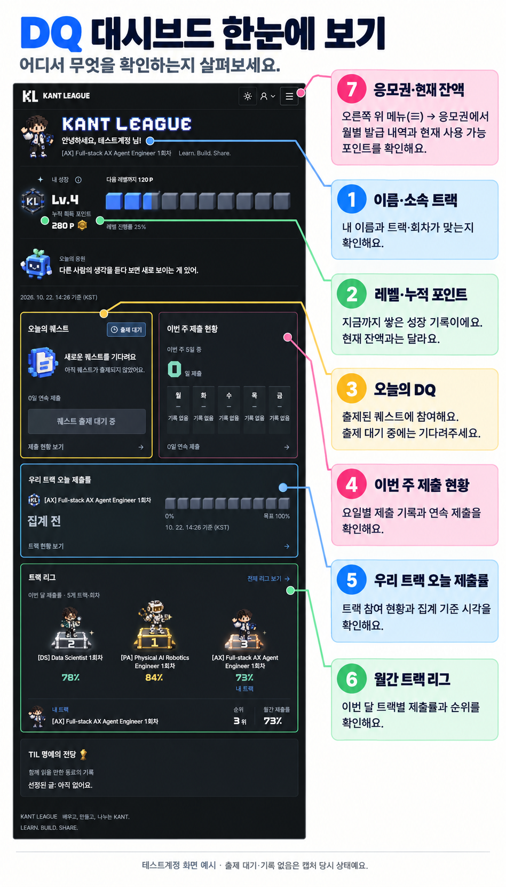

# 🎟️ [KANT] DQ(데일리 퀘스트) 대시보드 & 럭키드로우 가이드 (1)

- 문서 ID: NOTION-010
- 분류: 필독
- Notion 원문: https://app.notion.com/p/4216d0d25caa80b49254cb6d3ea4852e
- 수집일: 2026-11-23
- Notion 최종 수정 시각: 2026-11-23T01:55:29.101Z

<callout icon="💡" color="gray_bg">
DQ 대시보드에서 내 제출 기록과 포인트, 트랙 현황을 확인할 수 있어요.  DQ에 꾸준히 참여해 모은 포인트는 매월 럭키드로우 응모권으로 자동 전환돼요.
</callout>

 처음 접속하는 분은 아래 순서대로 확인해주세요.

<table-of-contents color="blue" />

### 🔑 1. 대시보드에 접속해 주세요

<callout icon="🔗">
[<b>KANT DQ 대시보드 바로가기</b>](https://kant-dq-dashboard-kant10.vercel.app) DQ 참여 → 포인트 적립 → 응모권 전환 → 월간 럭키드로우
</callout>

1. 링크를 열고 Google 로그인을 선택해주세요.
2. 수강생으로 등록된 Google 계정으로 로그인해주세요.
3. 화면에 표시된 이름과 트랙이 본인 정보와 맞는지 확인해주세요.

개인용 계정 등 다른 계정으로 로그인하면 수강생 정보를 찾지 못할 수 있어요.  등록한 이메일이 기억나지 않거나 이름·트랙이 다르면 담임매니저에게 알려주세요.

---

### 📝 2. 오늘 DQ에 참여하고 기록을 확인해요

대시보드의 퀘스트 메뉴에서 오늘 DQ를 확인하고, 연결된 퀘스트 링크로 이동해 문제를 풀고 제출해주세요. 대시보드에 접속하거나 퀘스트 링크를 열기만 한 것은 DQ 제출로 처리되지 않아요.

제출 후에는 대시보드에서 내 기록을 확인할 수 있어요. 다만 제출 기록과 집계는 즉시 반영되지 않을 수 있으니, 방금 제출했다면 조금 뒤에 다시 확인해주세요. 화면의 집계 기준 시각도 함께 확인하면 좋아요.

메뉴별로 볼 수 있는 내용은 아래와 같아요.

<table fit-page-width="true" header-row="true">
<colgroup>
<col width="86.52083587646484" />
<col width="370.20001220703125" />
</colgroup>
<tr>
<td>
메뉴
</td>
<td>
확인할 수 있는 내용
</td>
</tr>
<tr color="blue_bg">
<td>
<b>대시보드</b>
</td>
<td>
내 참여 현황, 포인트와 레벨, 트랙 리그 현황을 확인해요.
</td>
</tr>
<tr color="green_bg">
<td>
<b>퀘스트</b>
</td>
<td>
오늘 DQ와 지난 제출 기록을 확인해요.
</td>
</tr>
<tr color="yellow_bg">
<td>
<b>트랙</b>
</td>
<td>
내 트랙의 참여 현황을 확인해요.
</td>
</tr>
<tr color="pink_bg">
<td>
<b>리그</b>
</td>
<td>
트랙별 제출율과 순위를 확인해요.
</td>
</tr>
<tr color="orange_bg">
<td>
<b>응모권</b>
</td>
<td>
현재 사용 가능한 포인트와 월별 응모권 발급 내역을 확인해요.
</td>
</tr>
</table>

갱신 대기 안내가 보이면 마지막으로 확인된 집계가 표시되고 있는 상태예요.  이때는 함께 표시되는 기준 시각과 집계 기간을 보고 확인해주세요.

---

### ⭐ 3. 포인트는 이렇게 쌓여요

<table fit-page-width="true" header-row="true">
<tr>
<td>
활동
</td>
<td>
적립 포인트
</td>
</tr>
<tr color="blue_bg">
<td>
일일 대시보드 방문
</td>
<td>
10P
</td>
</tr>
<tr color="blue_bg">
<td>
일일 DQ 제출
</td>
<td>
30P
</td>
</tr>
<tr color="green_bg">
<td>
5일 연속 제출 달성
</td>
<td>
50P
</td>
</tr>
<tr color="green_bg">
<td>
10일 연속 제출 달성
</td>
<td>
100P
</td>
</tr>
<tr color="green_bg">
<td>
20일 연속 제출 달성
</td>
<td>
200P
</td>
</tr>
<tr color="pink_bg">
<td>
우수 TIL 선정
</td>
<td>
200P
</td>
</tr>
<tr color="yellow_bg">
<td>
월간 트랙 리그 1위 / 2위 / 3위
</td>
<td>
200P / 100P / 50P
</td>
</tr>
</table>

일일 방문과 제출 포인트는 같은 날 여러 번 접속하거나 제출한다고 반복해서 쌓이지 않아요. 연속 제출 포인트는 해당 연속 제출 일수를 달성했을 때 지급돼요. 주말과 공휴일은 연속 제출 일수에 포함하지 않아요.

트랙 리그 보너스는 해당 월 1\~3위 트랙의 수강생 중, <b>본인 트랙에서 출제된 DQ의 50% 이상을 제출한 수강생</b>에게 지급돼요.  ⇒ 예를 들어 그 달 DQ가 10번 출제되었다면 5번 이상 제출해야 해요.

<callout icon="📌">
50% 제출 조건은 트랙 리그 보너스를 받기 위한 조건이에요. 일반 포인트의 응모권 전환에 동일한 조건이 붙는 것은 아니에요.
</callout>

---

### 🎟️ 4. 200P가 응모권 1장으로 바뀌어요

매월 정산할 때 전환 대상 포인트 200P당 응모권 1장이 자동으로 발급돼요. 별도로 전환 버튼을 누르거나 응모권 수를 신청할 필요는 없어요.

응모권으로 바뀐 만큼의 포인트는 사용 처리되고, 200P 미만으로 남은 포인트는 다음 달로 이어져요. 다음 달에 새로 적립한 포인트가 이전 달 응모권에 섞여 전환되지는 않아요.

<callout icon="🎟️">
예를 들어 전환 대상 포인트가 650P라면 다음과 같이 처리돼요.

- 응모권 3장 발급
- 600P 사용
- 남은 50P는 다음 달로 이월
</callout>

예를 들어 전환 대상 포인트가 650P라면 다음과 같이 처리돼요.

- 응모권 3장 발급
- 600P 사용
- 남은 50P는 다음 달로 이월

포인트가 응모권으로 전환되어도 그 전환 때문에 레벨이 내려가지는 않아요. 레벨에 반영되는 누적 획득 포인트와 지금 사용할 수 있는 포인트 잔액은 서로 다르기 때문이에요. 홈의 누적 획득 포인트와 응모권 화면의 현재 사용 가능 포인트가 달라도 이 차이 때문일 수 있어요.

---

### 🔎 5. 응모권 화면은 이렇게 확인해주세요

응모권 메뉴에 들어가면 제목 오른쪽에서 현재 사용 가능한 포인트를 볼 수 있어요. 이 숫자는 선택한 달의 잔액이 아니라, 지금 남아 있는 잔액이에요.

월을 선택하면 아래 항목이 순서대로 표시돼요.

1. 발급 응모권: 선택한 달에 발급된 응모권 수예요.
2. 이월 포인트: 선택한 달의 이월 기록이에요.
3. 사용 포인트: 선택한 달의 응모권 발급에 사용된 포인트예요.

지난달 응모권을 확인하려면 조회 월을 지난달로 바꿔주세요. 이전 발급 기록도 함께 확인할 수 있어요.

<callout icon="🔎">
이월 포인트가 ‘—’로 보이면 해당 월의 저장된 이월값이 없다는 뜻이에요. 0P라는 뜻은 아니에요. 현재 남은 포인트는 화면 오른쪽 위의 현재 사용 가능 포인트를 확인해주세요.
</callout>

이월 포인트가 ‘—’로 보이면 해당 월의 저장된 이월값이 없다는 뜻이에요. 0P라는 뜻은 아니에요. 현재 남은 포인트는 화면 오른쪽 위의 현재 사용 가능 포인트를 확인해주세요.

이번 달이 아직 정산되지 않았다면 포인트가 쌓여 있어도 이번 달 발급 내역은 없을 수 있어요. 월별 발급 내역과 현재 잔액을 구분해서 확인해주세요.

---

### 🎁 6. 월간 럭키드로우는 이렇게 진행돼요

운영진이 월별 발급 응모권을 기준으로 추첨을 진행해요. 수강생이 직접 룰렛에 이름이나 응모권 수를 입력할 필요는 없어요.

상품은 아래 구성으로 준비해요.

- 배민 2만원권
- 알찬푸드 식권 2장
- 알찬푸드 식권 1장
- 커피상품권 2장
- 커피상품권 1장

정확한 추첨 일정과 참여 안내, 당첨 결과 및 상품 수령 방법은 별도 공지로 안내드릴게요. 해당 월의 럭키드로우 공지를 함께 확인해주세요.

※ 상품 구성에는 변동이 생길 수 있습니다.

---

### 💬 7. 자주 묻는 질문

<callout icon="💬">
<b>제출했는데 미제출로 보여요.</b> 방금 제출했다면 기록 반영까지 시간이 걸릴 수 있어요. 로그인 계정과 제출 날짜, 화면의 집계 기준을 먼저 확인해주세요. 시간이 지난 뒤에도 다르면 담임매니저에게 알려주세요.
</callout>

<b>제출했는데 미제출로 보여요.</b> 방금 제출했다면 기록 반영까지 시간이 걸릴 수 있어요. 로그인 계정과 제출 날짜, 화면의 집계 기준을 먼저 확인해주세요. 시간이 지난 뒤에도 다르면 담임매니저에게 알려주세요.

<callout icon="💬">
<b>집계 전 또는 갱신 대기로 표시돼요.</b> 집계 전은 아직 확인된 집계가 없는 상태예요. 갱신 대기는 이전에 확인된 같은 달의 집계를 보여주는 상태이므로, 표시된 시각과 기간을 함께 확인해주세요. 두 표시를 미제출이나 0%라는 의미로 받아들이지 않아도 돼요.
</callout>

<b>집계 전 또는 갱신 대기로 표시돼요.</b> 집계 전은 아직 확인된 집계가 없는 상태예요. 갱신 대기는 이전에 확인된 같은 달의 집계를 보여주는 상태이므로, 표시된 시각과 기간을 함께 확인해주세요. 두 표시를 미제출이나 0%라는 의미로 받아들이지 않아도 돼요.

<callout icon="💬">
<b>포인트는 있는데 응모권이 없어요.</b> 응모권은 포인트를 얻을 때마다 즉시 발급되는 것이 아니라 월별 정산 때 전환돼요. 선택한 월이 맞는지와 해당 월의 발급 내역을 확인해주세요. 전환 대상 포인트가 200P 미만이면 응모권 대신 포인트로 남아요.
</callout>

<b>포인트는 있는데 응모권이 없어요.</b> 응모권은 포인트를 얻을 때마다 즉시 발급되는 것이 아니라 월별 정산 때 전환돼요. 선택한 월이 맞는지와 해당 월의 발급 내역을 확인해주세요. 전환 대상 포인트가 200P 미만이면 응모권 대신 포인트로 남아요.

<callout icon="💬">
<b>기록이 계속 다르거나 로그인이 안 돼요.</b> 담임매니저에게 DM으로 등록 이메일, 확인하려는 날짜나 월, 문제가 보이는 화면 캡처를 보내주세요. 비밀번호나 인증 코드는 보내지 않아도 돼요. 확인이 필요한 부분을 함께 남겨주시면 더 빠르게 살펴볼 수 있어요.
</callout>

<b>기록이 계속 다르거나 로그인이 안 돼요.</b> 담임매니저에게 DM으로 등록 이메일, 확인하려는 날짜나 월, 문제가 보이는 화면 캡처를 보내주세요. 비밀번호나 인증 코드는 보내지 않아도 돼요. 확인이 필요한 부분을 함께 남겨주시면 더 빠르게 살펴볼 수 있어요.

---

추가적으로 궁금하신 내용이나 건의사항이 있다면 해당 트랙의 담임매니저에게 문의주세요!
