# [KANT] 비상 상황 대응 가이드

- 문서 ID: NOTION-012
- Notion 원문: https://app.notion.com/p/4216d0d25caa80e99c96cacdab8755c2
- 수집일: 2026-11-23
- Notion 최종 수정 시각: 2026-11-23T01:59:16.828Z

- <b>비상 상황이 발생하면 당황하지 말고, 아래 안내에 따라 행동해주세요.</b>
- 무엇보다 본인과 주변 사람의 안전을 먼저 확보하고, 생명이나 신체에 위험이 있다고 판단되면  운영진의 승인을 기다리지 말고 <b>바로 119 또는 112에 신고해주세요.</b>

<callout icon="☎️" color="orange_bg">
### <b>긴급 신고</b>
</callout>

- <b>응급환자, 화재, 연기 발생: 119</b>
- <b>폭력, 침입, 범죄 위험: 112</b>
- <b>신고 주소 : 서울특별시 구로구 디지털로 33길 48 대륭포스트타워 7차 15층 또는 16층</b>
  - 신고할 때는 아래 내용을 함께 알려주세요.
    - 건물명과 정확한 층
    - 강의실 또는 사고 발생 장소
    - 현재 상황과 위험 요소
    - 부상자 또는 대피 인원
    - 신고자의 이름과 연락처

<callout icon="📍" color="orange_bg">
### <b>화재 또는 지진으로 대피한 경우</b>
</callout>

- <b>건물 1층 정문 앞 공터</b>로 모여주세요.
  - 집결 후 과정 별로 인원을 확인합니다.
  - 소방대원 또는 운영진의 안내가 있기 전까지 건물에 다시 들어가지 않습니다.
  - 개인 물품을 가지러 다시 올라가지 않습니다.

---

<callout icon="🚨" color="orange_bg">
### <b>비상시 첫 행동</b>
</callout>

- 🆘 <b>응급 환자 </b>: 반응과 호흡을 확인하고, 생명 위험이 의심되면 119
- 🔥 <b>화재</b> : “불이야”라고 알리고 비상벨을 누른 뒤 연기 없는 계단으로 대피
- 🫨 <b>지진</b> : 흔들리는 동안 머리와 목을 보호하고, 멈춘 뒤 계단으로 대피
- 🔦 <b>정전</b> : 이동을 멈추고 연기, 불꽃, 탄 냄새 등 화재 징후 확인
- 🚨 <b>폭력 또는 침입</b> : 안전한 출구가 있으면 탈출하고, 어렵다면 문을 잠그고 숨어 112 신고

---

<callout icon="🗺️" color="orange_bg">
### <b>강의실 별 비상 대피도</b>
</callout>

- <b>대피도 확인 방법</b>
  - 초록색 화살표는 가까운 피난 계단으로 이동하는 기본 경로입니다.
  - 기본 경로에 연기, 열기 또는 심한 혼잡이 있으면 주황색 대체 경로를 이용해주세요.
  - 두 경로 모두 위험하면 무리하게 진입하지 말고 안전한 실내로 이동한 뒤 운영진 또는 소방대원원의 안내를 기다려주세요.
- <b>대피 시 유의 사항</b>
  - 일반 승객용 승강기는 사용하지 않습니다.
  - 운영진의 안내에 따라 강의실 별로 순서대로 이동합니다.
  - 앞 사람을 밀거나 뛰지 않습니다.
  - 떨어진 물건을 줍기 위해 갑자기 멈추거나 몸을 숙이지 않습니다.
  - 대피 후 건물 1층 정문 앞 공터에서 과정 별로 인원을 확인합니다.
- <b>15층</b>
  <toggle color="blue_bg">
  🔵 AX 1반 - BASE CAMP 1

  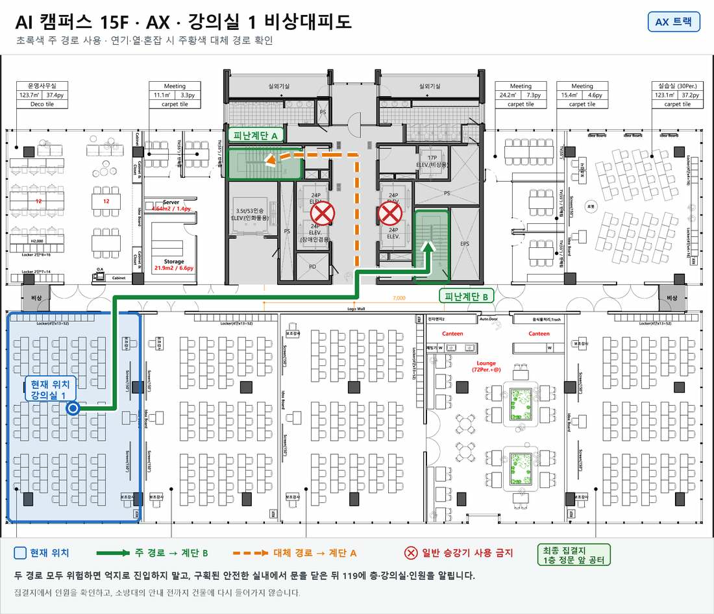
  </toggle>

  <toggle color="blue_bg">
  🔵 AX 2반 - BASE CAMP 2

  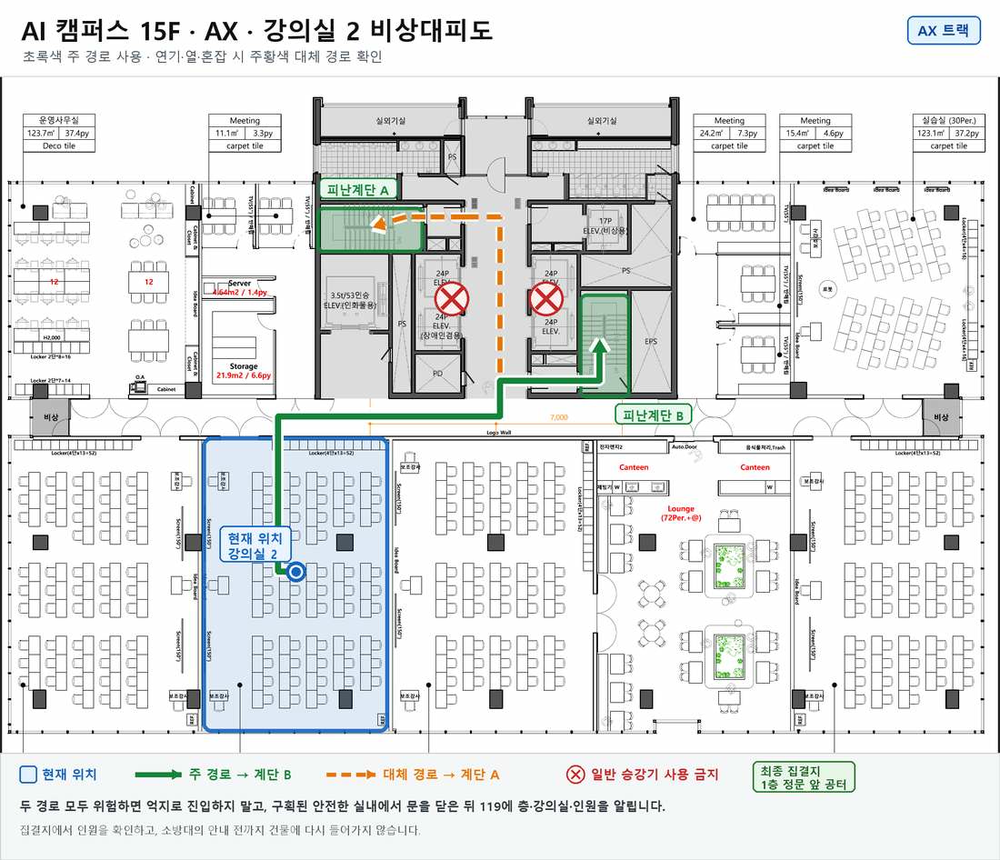
  </toggle>

  <toggle color="green_bg">
  🟢 PA - BASE CAMP 4

  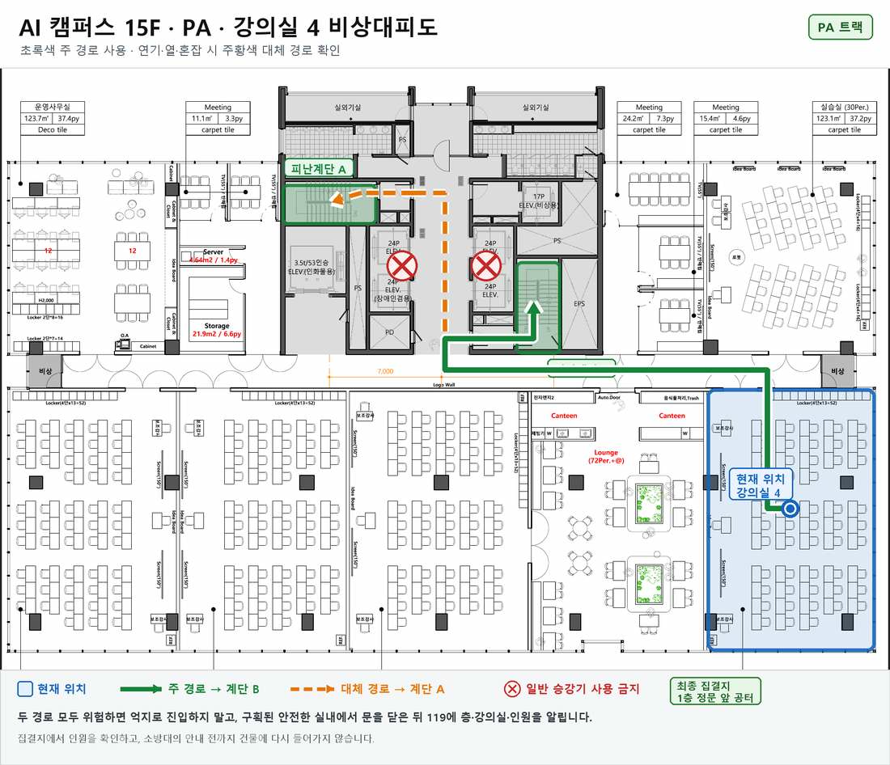
  </toggle>

  <toggle color="green_bg">
  🟢 PA - CORE LAB

  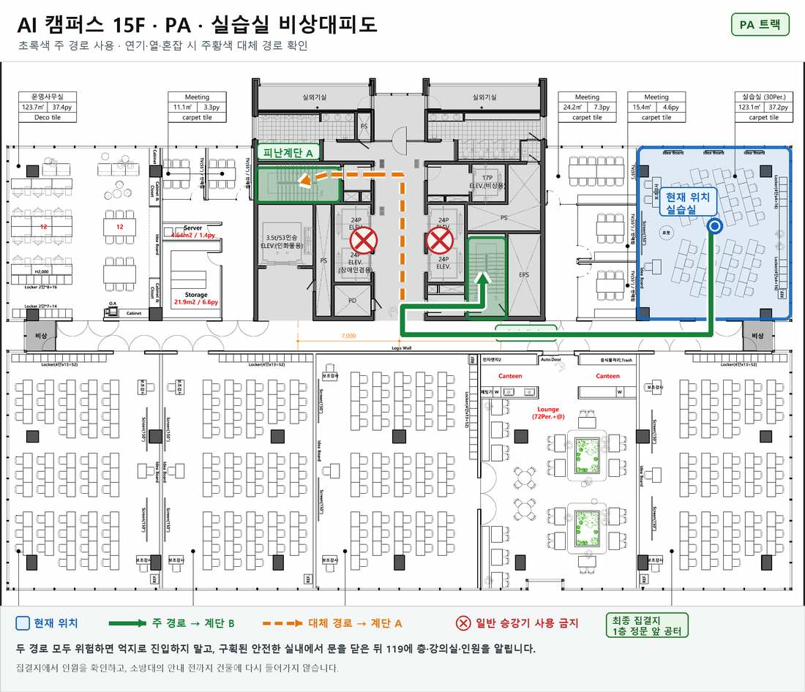
  </toggle>
- 16층
  <toggle color="purple_bg">
  🟣 LLM - BASE CAMP 5

  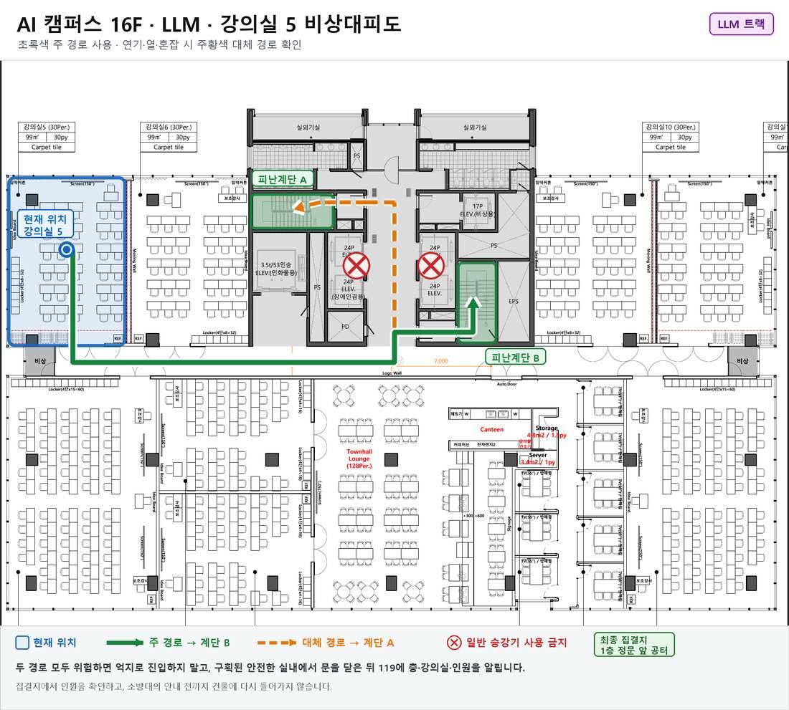
  </toggle>

  <toggle color="orange_bg">
  🟠 DS - BASE CAMP 7

  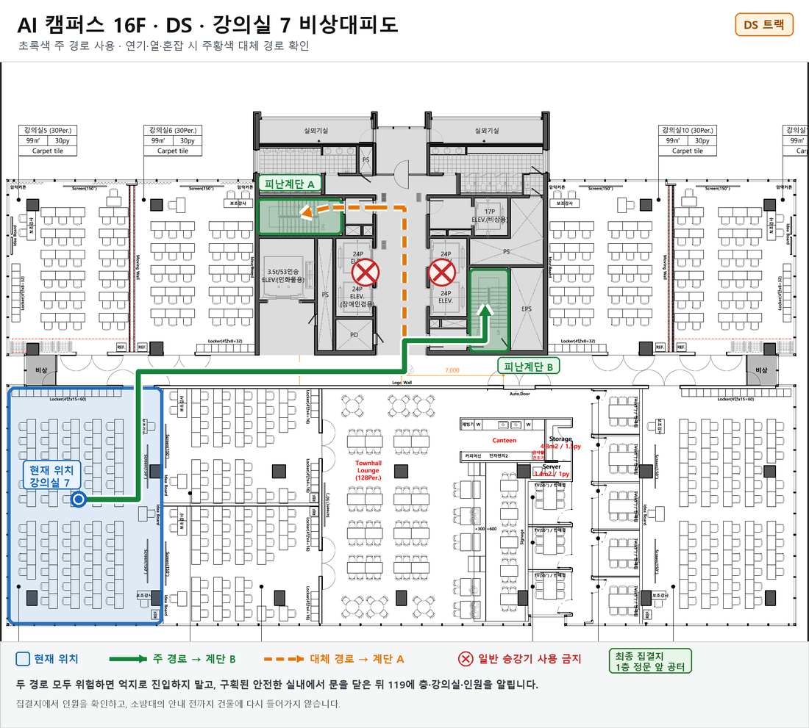
  </toggle>

---

<callout icon="🆘" color="orange_bg">
### <b>응급 환자 발생 시</b>
</callout>

- 반응이 없거나 정상적으로 호흡하지 않는 경우, 심한 호흡곤란, 흉통, 마비, 출혈, 중증 외상, 화상, 중독, 경련 등 생명 위험이 의심되면 즉시 119에 신고해주세요.
- <b>기본 대응 순서</b>
  1. 주변에 추가 위험이 없는지 먼저 확인합니다.
  2. 환자에게 말을 걸고 어깨를 가볍게 두드려 반응을 확인합니다.
  3. 가슴과 배의 움직임을 보고 정상적으로 호흡하는지 확인합니다.
  4. 특정 사람을 지목해 119 신고와 구급대 진입 안내를 요청합니다.
  5. 반응과 정상 호흡이 없으면 119 상황 요원의 안내에 따라 가슴 압박을 시작합니다.
  6. 가장 가까운 운영진에게 상황을 알립니다.
  7. 구급대가 도착하면 발생 시각, 상태 변화, 시행한 조치를 전달합니다.

⚠️ <b>유의 사항</b>

- 의식이 없거나 삼키기 어려운 환자에게 음식, 물, 약을 주지 않습니다.
- 주변이 안전한 경우 환자를 불필요하게 옮기지 않습니다.
- 환자의 사진이나 개인정보를 단체방 또는 개인 SNS에 공유하지 않습니다.
- 병명을 추측하기보다 눈앞에 보이는 증상을 기준으로 대응합니다.

⚠️ <b>상황별 대응 방법</b>

<toggle>
<b>갑자기 쓰러졌을 때</b>

- <b>실신이 의심되는 경우</b>
  - 안전한 곳에 눕힙니다.
  - 의식이 있고 외상이 없다면 다리를 조금 높여줍니다.
  - 의식이 흐리지만 정상 호흡을 하거나 구토할 경우 몸을 옆으로 돌려줍니다.
  - 바로 일으켜 세우거나 걷게 하지 않습니다.
  - 의식이 돌아오지 않거나 호흡 이상, 흉통, 외상, 경련이 있으면 119에 신고합니다.
</toggle>

<toggle>
<b>몸을 떨거나 굳고 반응이 없을 때</b>

- <b>경련이 의심되는 경우</b>
  - 경련이 시작된 시간을 확인합니다.
  - 주변의 위험한 물건과 안경을 치웁니다.
  - 접은 옷이나 수건으로 머리를 보호합니다.
  - 몸을 억지로 붙잡거나 움직임을 막지 않습니다.
  - 입에 손가락, 숟가락 또는 다른 물건을 넣지 않습니다.
  - 경련이 멈춘 뒤 정상 호흡을 확인하고 몸을 옆으로 돌려줍니다.
  - 첫 경련이거나 5분 이상 지속되는 경우, 반복되는 경우, 호흡 이상 또는 외상이 있으면 119에 신고합니다.
</toggle>

<toggle>
<b>숨을 빠르게 쉬고 손발이 저릴 때</b>

- <b>과호흡 또는 공황이 의심되는 경우</b>
  - 조용하고 안전한 곳에 앉히거나 눕힙니다.
  - 조이는 옷을 풀어줍니다.
  - 코로 천천히 들이마시고 입으로 더 길게 내쉬도록 안내합니다.
  - 종이봉투나 비닐봉투를 입과 코에 대지 않습니다.
  - 흉통, 청색증, 실신, 경련 또는 의식 저하가 있거나 증상이 계속 악화되면 119에 신고합니다.
</toggle>

<toggle>
<b>식은땀, 떨림, 멍한 모습이 보일 때</b>

- <b>저혈당이 의심되는 경우</b>
  - 의식이 있고 안전하게 삼킬 수 있을 때만 당분이 포함된 음식이나 음료를 제공합니다.
  - 설탕 또는 꿀 15g, 사탕 3개에서 4개, 주스나 일반 탄산음료 약 3분의 2컵 정도를 제공할 수 있습니다.
  - 15분 뒤에도 회복되지 않으면 한 번 더 제공합니다.
  - 의식이 흐리거나 삼키기 어렵거나 경련이 있으면 아무것도 먹이지 말고 119에 신고합니다.
  - 인슐린이나 약을 임의로 사용하지 않습니다.
</toggle>

<callout icon="♥️" color="orange_bg">
### <b>심폐소생술</b>
</callout>

- <b>반응과 정상 호흡이 없으면 119 상황 요원의 안내에 따라 가슴 압박을 시작해주세요.</b>
- 인공호흡은 관련 교육을 받았고 안전하게 시행할 수 있는 경우에만 진행합니다. 그렇지 않으면 가슴압박을 계속해주세요.

<toggle>
<b>심폐소생술 순서</b>

<columns>
<column ratio="50">
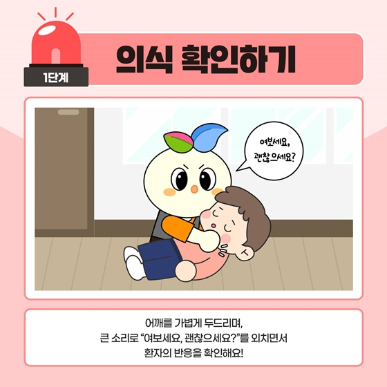
</column>
<column ratio="50">

</column>
</columns>

<columns>
<column ratio="50">
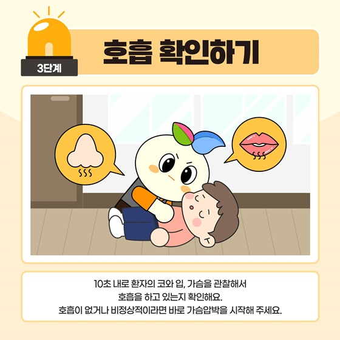
</column>
<column ratio="50">
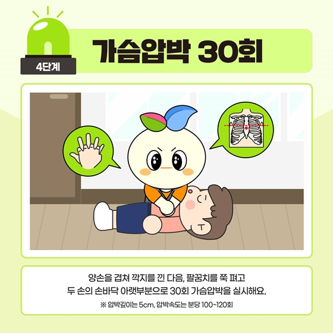
</column>
</columns>

<columns>
<column ratio="50">
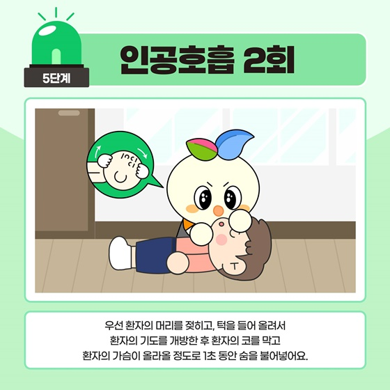
</column>
<column ratio="50">
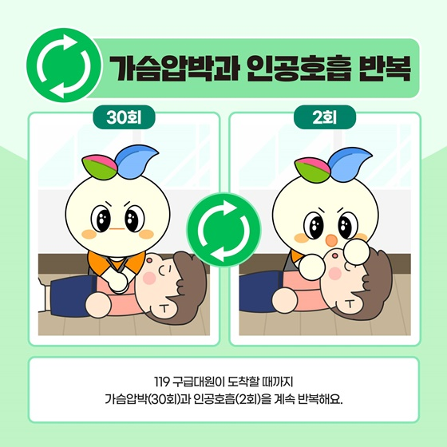
</column>
</columns>

<columns>
<column ratio="50">
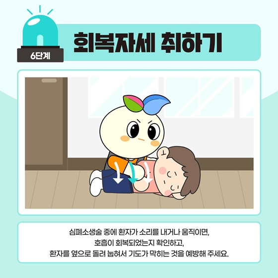
</column>
<column ratio="50">
<callout icon="☎️" color="gray_bg">
<b>구급대가 올 때까지</b>

- 환자의 반응·호흡 변화를 계속 확인합니다.
- 구조대에 발생 시각과 시행한 처치를 인계 합니다.
</callout>
</column>
</columns>
</toggle>

<callout icon="☎️" color="orange_bg">
### <b>119 신고 예시</b>
</callout>

- <b>“응급 환자가 발생했습니다. 위치는 AI 캠퍼스, 서울특별시 구로구 디지털로33길 48 대륭포스트타워7차, 15층 또는 16층의 BASECAME 1 강의실입니다.”</b>
- 환자의 의식 여부, 호흡 상태, 주요 증상과 현재 시행 중인 조치를 함께 말씀해주세요.
- 신고 후 전화를 먼저 끊지 않습니다.
- 안내자가 1층에서 구급대를 기다리고 진입 경로를 안내합니다.
- 구급대가 올 때까지 환자의 반응과 호흡 변화를 계속 확인합니다.

---

<callout icon="🔥" color="orange_bg">
### <b>화재 발생 시</b>
</callout>

- <b>화재가 발생하면 대피가 가장 먼저입니다.</b>

<toggle>
<b>화재 대응 순서</b>

1. 주변에 크게 <b>“불이야”</b>라고 알립니다.
2. 가까운 비상벨을 누릅니다.
3. 문을 열기 전 손등으로 문과 손잡이의 열을 확인합니다.
4. 문이 뜨겁거나 연기와 열기가 느껴지면 열지 않고 다른 경로를 찾습니다.
5. 개인 물품은 두고 몸을 낮춰 연기 없는 피난계단으로 이동합니다.
6. 마지막 사람은 가능한 범위에서 문을 닫되 잠그지 않습니다.
7. 안전한 장소에서 119에 층, 화재 위치, 연기 상태와 고립 인원을 알립니다.
8. 건물 1층 정문 앞 공터에서 과정별 인원을 확인합니다.
</toggle>

<toggle>
<b>유의 사항</b>

- 일반 승객용 승강기는 사용하지 않습니다.
- 연기와 열기가 있는 계단으로 무리하게 진입하지 않습니다.
- 소지품을 가지러 강의실로 다시 돌아가지 않습니다.
- 소방대원의 안내 전까지 건물에 다시 들어가지 않습니다.
</toggle>

<toggle>
<b>연기가 있는 곳을 지나야 할 때</b>

- 바로 사용할 수 있는 옷소매, 손수건 등으로 코와 입을 가립니다.
- 수건을 찾거나 물에 적시느라 대피를 늦추지 않습니다.
- 허리를 숙이거나 팔과 무릎을 이용해 낮은 자세로 이동합니다.
- 앞이 보이지 않거나 숨쉬기 어렵고 열기가 강해지면 즉시 돌아갑니다.
- 두 계단 모두 위험하면 연기와 열기가 없는 실내로 이동한 뒤 문을 닫습니다.
- 119에 정확한 층, 강의실, 인원과 현재 위치를 알립니다.
</toggle>

<toggle>
<b>소화기 사용 방법</b>

- <b>소화기는 불이 작고 연기가 많지 않으며, 등 뒤에 안전한 탈출로가 있을 때만 사용해주세요.</b>
- 조금이라도 위험해지면 즉시 포기하고 대피합니다.
- <b>사용 순서</b>
  1. 안전핀을 뽑습니다.
  2. 노즐을 불의 밑부분으로 향합니다.
  3. 손잡이를 힘껏 움켜쥡니다.
  4. 좌우로 빗자루 쓸 듯 분사합니다.

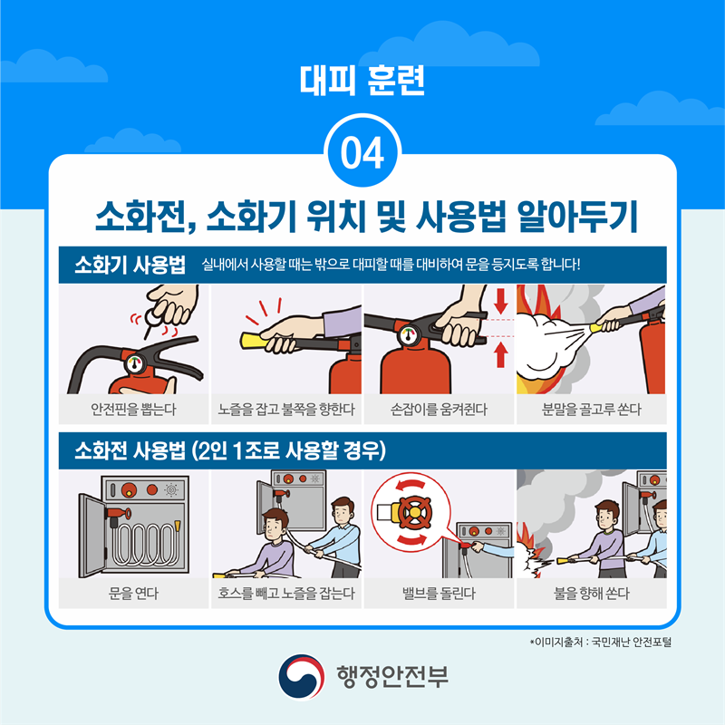
</toggle>

<toggle>
<b>완강기 사용</b>

- 화재, 지진, 정전 시 일반 승객용 승강기는 사용하지 않습니다.
- 15층과 16층의 기본 대피 경로는 피난계단입니다.
- 완강기를 이용하기 위해 다른 층으로 이동하지 않습니다.
- 실제 완강기가 설치된 층에 있고, 계단과 복도를 이용할 수 없는 경우에만 사용을 검토합니다.
- 사용이 필요한 경우 가능하면 119 상황요원 또는 운영진의 안내에 따라주세요.

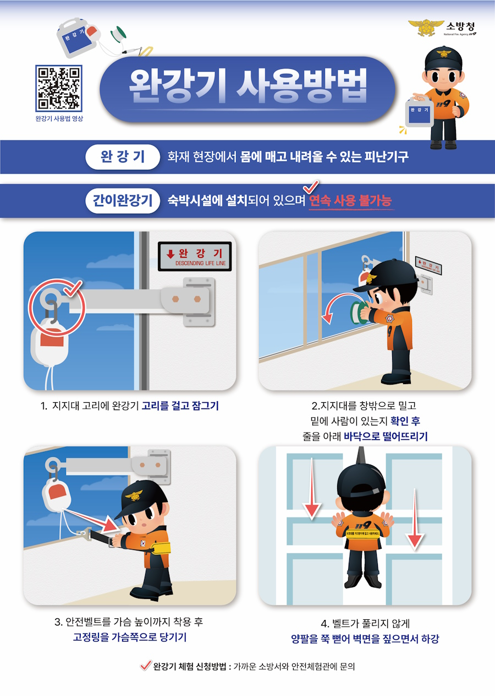
</toggle>

<toggle>
<b>방화문 사용</b>

- <b>방화문은 화재와 연기의 확산을 막기 위한 안전설비입니다.</b>
  - 고무 쐐기, 도어스토퍼, 의자, 끈 또는 테이프로 상시 고정하지 않습니다.
  - 방화문 앞과 문이 열리고 닫히는 범위에 물건을 두지 않습니다.
  - 물품 운반으로 잠시 열어야 하는 경우 사람이 직접 잡고 있다가 통과 후 즉시 닫습니다.
  - 문이 완전히 닫히지 않거나 고장이 의심되면 운영진에게 알려주세요.
</toggle>

---

<callout icon="🚨" color="orange_bg">
### <b>지진 발생 시</b>
</callout>

- <b>15층과 16층은 지상층보다 흔들림이 크고 오래 느껴질 수 있습니다.</b>
- <b>흔들리는 동안 복도나 계단으로 뛰어나가지 말고, 가까운 곳에서 몸을 낮추고 머리와 목을 보호해주세요.</b>
  1. 창문, 외벽, 높은 가구와 가까이 있다면 무리하지 않는 범위에서만 벗어납니다.
  2. 튼튼한 책상이 가까우면 책상 아래로 들어갑니다.
  3. 한 팔로 머리와 목을 보호하고 다른 손으로 책상 다리를 잡습니다.
  4. 책상이 없다면 낙하물이 없는 안쪽 벽 또는 기둥 가까이에서 몸을 웅크립니다.
  5. 복도나 계단에 있다면 이동을 멈추고 몸을 낮춘 뒤 손잡이나 지지물을 잡습니다.
  6. 승강기는 새로 타지 않습니다.
  7. 이미 승강기 안이라면 모든 층 버튼을 누르고 가장 먼저 문이 열린 층에서 내립니다.
  8. 승강기에 갇혔다면 비상호출로 구조를 요청하고 문을 강제로 열지 않습니다.
- <b>흔들림이 멈춘 뒤</b>
  1. 부상자와 화재, 연기, 낙하물, 계단 파손 여부를 확인합니다.
  2. 화재 또는 연기가 있으면 비상벨과 119 신고 후 화재 대응 절차로 전환합니다.
  3. 머리와 목을 보호하며 연기 없는 피난계단으로 이동합니다.
  4. 이동 중 다시 흔들리면 즉시 멈추고 몸을 보호합니다.
  5. 두 계단 모두 위험하면 안전한 실내로 이동해 문을 닫고 119와 방재실에 위치를 알립니다.
  6. 건물 1층 정문 앞 공터에서 과정별 인원을 확인합니다.
  7. 운영진 또는 관계 기관의 안내 전까지 건물에 다시 들어가지 않습니다.

---

<callout icon="🔦" color="orange_bg">
### <b>정전 발생 시</b>
</callout>

- <b>정전 대응 순서</b>
  1. 수업과 이동을 멈춥니다.
  2. 비상조명 아래에서 인원을 확인합니다.
  3. 연기, 탄 냄새, 불꽃, 이상한 열기 또는 경보가 있는지 확인합니다.
  4. 화재 징후가 있으면 즉시 화재 대응 절차로 전환합니다.
  5. 단순 정전으로 확인되면 방재실과 운영진의 안내에 따라 대기합니다.
  6. 대피가 필요한 경우 휴대조명과 계단 안전이 확인된 후 순서대로 이동합니다.
  7. 정전 중에는 승강기를 이용하지 않습니다.
  8. 일반 수강생과 운영진은 분전반, 차단기 또는 승강기 문을 임의로 조작하지 않습니다.
  9. 전력이 복구된 뒤에도 건물 관리자가 정상 운행을 확인하기 전까지 승강기를 이용하지 않습니다.
- <b>승강기에 갇혔을 때</b>
  - 승강기 문을 강제로 열거나 스스로 빠져나오지 않습니다.
  - 비상 호출 버튼 또는 휴대전화로 구조를 요청하고 안내를 기다려주세요.
    1. 비상 호출 버튼을 눌러 관리실 또는 유지 관리 업체에 연락합니다.
    2. 연결되지 않으면 휴대전화로 119에 신고합니다.
    3. 건물명과 주소, 현재 층 또는 호기, 갇힌 인원과 부상 여부를 알립니다.
    4. 확인할 수 있다면 승강기 내부에 표시된 7자리 고유 번호를 전달합니다.
    5. 출입문과 비상 환기구를 강제로 열지 않습니다.
    6. 문이 열리더라도 구조 요원의 안내 없이 임의로 이동하지 않습니다.
    7. 안전 손잡이를 잡고 침착하게 대기합니다.
- <b>절대 하지 말아야 할 행동</b>
  - 승강기 문 강제 개방
  - 비상 환기구 개방
  - 승강기와 승강장 사이로 탈출 시도

---

<callout icon="🚨" color="orange_bg">
### <b>폭력 또는 외부인 침입 시</b>
</callout>

- <b>위협자를 직접 확인하거나 제지하기 위해 접근하지 않습니다.</b>
- <b>화재 대피와 달리 정해진 집결지를 향해 무조건 이동하지 말고, 위협과 반대 방향의 안전한 경로를 선택해주세요.</b>
- <b>대응 순서</b>
  1. 안전한 출구가 명확하면 주변 사람과 함께 위협과 반대 방향으로 벗어납니다.
  2. 탈출하는 것이 더 위험하면 문을 잠그거나 가구로 막습니다.
  3. 출입문과 창문에서 보이지 않는 곳에 숨습니다.
  4. 안전이 확보된 상태에서 112에 신고합니다.
  5. 휴대전화의 소리와 진동을 끄고 화면 밝기를 낮춥니다.
  6. 경찰이 도착하기 전까지 문을 열거나 자신의 위치를 노출하지 않습니다.
  7. 경찰이 도착하면 손이 보이도록 하고 갑작스러운 움직임을 피합니다.
- <b>112 신고 시 아래 내용을 알려주세요.</b>
  - 건물명과 주소
  - 층과 강의실
  - 위협자의 인상착의
  - 무기 소지 여부
  - 이동 방향
  - 부상자와 숨어 있는 인원
- <b>탈출과 은폐가 모두 불가능하고 생명이 즉시 위협 받는 경우에만 주변 사람과 협력해 자신을 보호합니다. </b>
- <b>위협자를 뒤쫓거나 숨어 있는 곳에서 먼저 접근하지 않습니다.</b>
