# [KANT] LMS(학습 공간) 가이드

- 문서 ID: NOTION-017
- Notion 원문: https://app.notion.com/p/4216d0d25caa8022be60c7f6df7d2ad8
- 수집일: 2026-11-23
- Notion 최종 수정 시각: 2026-11-23T02:05:03.894Z

<callout icon="notion://custom_emoji/83c75a39-3aba-4ba4-a792-7aefe4b07895/30c2dc3e-f514-8052-98d5-007a88daa225">
<b>LMS 가이드는 여러분들이 교육을 들으시면서 가장 많이 사용하게 되실 LMS에 대한 가이드입니다.</b>

<b>주요하게 사용되는 탭들에 대한 설명을 작성해두었으니 참고해주세요. </b>

> <b>KANT 홈페이지 로그인 ⇒ 프로필 클릭 ⇒ 학습 공간 LMS</b>

<table-of-contents color="gray" />

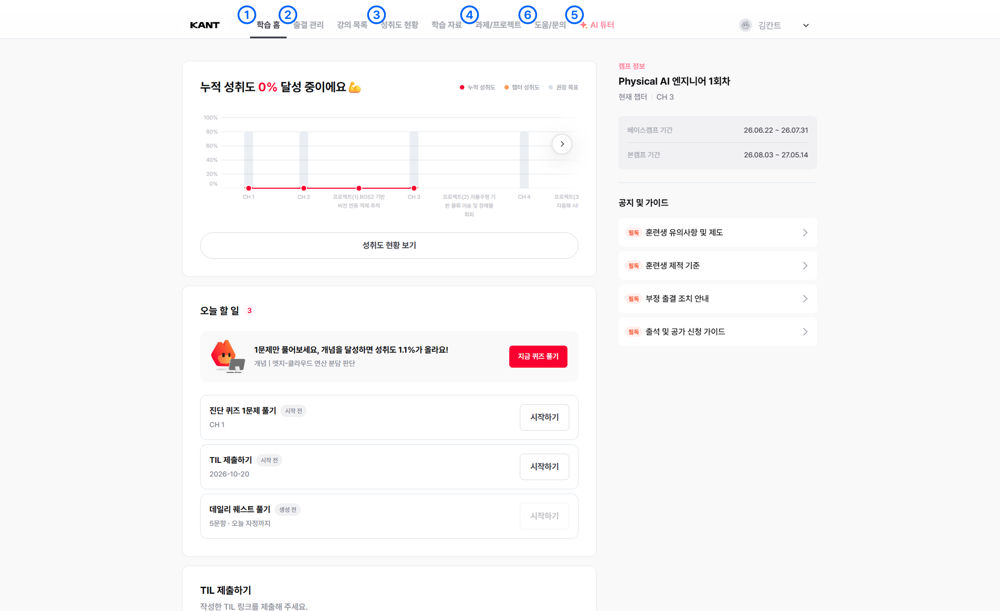
</callout>

<toggle heading="h2">
① 학습 홈

<callout icon="notion://custom_emoji/83c75a39-3aba-4ba4-a792-7aefe4b07895/2fe2dc3e-f514-8006-95d9-007a99d996b6">
<b>누적 성취도 및 오늘의 할일 제출, 공지를 확인할 수 있는 첫 화면입니다.  </b>앞으로 매일 이용하게 될 화면인 만큼, 어떤 정보와 기능이 있는지 미리 살펴보고 익숙해져  주세요.
</callout>

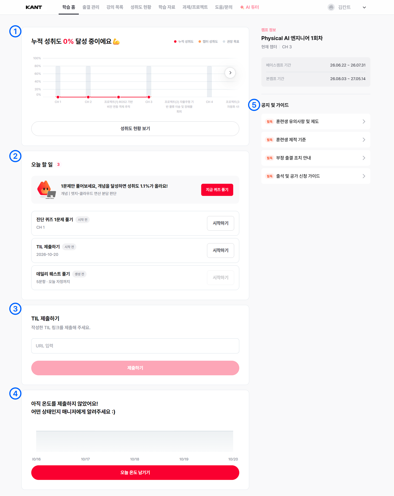

<callout icon="1️⃣">
<b>학습 성취도</b>

- 여러분의 학습 활동과 과제 수행 현황 등을 바탕으로 누적 성취도를 확인할 수 있습니다. 단순히 성취도를 확인하는 것을 넘어, 지금까지의 학습 진행 상황을 돌아보고 앞으로의 학습 방향과 목표를 점검하는 데 활용할 수 있습니다.
</callout>

<callout icon="2️⃣">
<b>오늘 할 일</b>

매일 수행해야 하는 학습 활동을 한눈에 확인할 수 있는 공간입니다.

<ul>
<li>
<b>진단 퀴즈 1문제 풀기</b>

- 간단한 퀴즈를 통해 학습 내용을 점검하고, 부족한 부분을 확인할 수 있습니다. 매일 한 문제씩 풀어보며 배운 내용을 꾸준히 복습해 보시기 바랍니다.
</li>
<li>
<b>TIL 제출</b> [( TIL 작성가이드)](/p/3fc2dc3ef514801db163cc9d7a0b25ad?pvs=25)

- TIL(Today I Learned)은 오늘 배운 내용과 새롭게 알게 된 점을 기록하는 학습 일지입니다. 하루의 학습을 돌아보고 배운 내용을 자신의 것으로 정리하는 데 도움이 됩니다.
</li>
<li>
<b>DQ</b> (데일리 퀘스트 풀기)

- 매일 제공되는 학습 문제를 통해 배운 내용을 직접 적용하고 이해도를 점검할 수 있습니다. 문제를 해결하는 과정에서 부족한 개념을 발견하고, 문제 해결 능력을 꾸준히 키워보시기 바랍니다.
</li>
<li>
진단 퀴즈와 데일리 퀘스트의 <b>‘시작하기’</b> 버튼을 클릭하면 AI 튜터 화면으로 이동합니다. AI 튜터에서는 해당 학습 활동에 대한 자세한 내용을 확인하고, 문제 풀이와 학습을 이어갈 수 있습니다.
</li>
</ul>
</callout>

<callout icon="3️⃣">
- TIL 제출하기
- 작성한 TIL의 링크를 입력해 간편하게 제출할 수 있는 공간입니다.
</callout>

<callout icon="4️⃣">
오늘의 온도 (학습 컨디션 제출하기)

여러분의 하루 학습 컨디션과 현재 상태를 공유할 수 있는 공간입니다.

</callout>

<callout icon="5️⃣">
공지 및 가이드

행정 관련 공지 및 가이드를 확인 하실 수 있습니다.
</callout>
</toggle>

<toggle heading="h2">
② 출결 관리

<callout icon="notion://custom_emoji/83c75a39-3aba-4ba4-a792-7aefe4b07895/2fe2dc3e-f514-8006-95d9-007a99d996b6">
<b>여러분들의 입실/퇴실 시간, 출석율, 공가 신청을 확인할 수 있는 탭입니다. </b>
</callout>

- 단위기간 출석률이 <b>50% 이하로 떨어지지 않도록</b> 출석에 각별히 신경 써주세요.
- 본인이 알고 있는 출석률과 LMS에 표시된 출석률이 다를 경우, 당황하지 마시고 담임매니저에게 정확한 출석률을 문의해주세요.
- <b>입실은 09:10 이전, 퇴실은 17:50\~23:59 사이</b>에 반드시 진행해주세요. 특히 퇴실 버튼을 누르지 않고 귀가하는 경우가 많으니, 퇴실 처리를 꼭 확인해주세요.
- <b>공가/휴가 신청</b>
  - 공가/휴가 신청은 발생일 기준 다음날 17시까지만 신청 가능합니다.
  - 다음날이 주말, 공휴일인 경우 다음 영업일 17시까지 신청 가능합니다.
  - 휴가는 <b>공가 신청</b>에 들어가신 후 <b>신청 사유</b>에서 선택하실 수 있습니다.
  - 휴가는 <b>단위 기간 당 1회씩 누적되며 잔여 휴가가 남아 있을 경우</b> 사용 가능합니다.

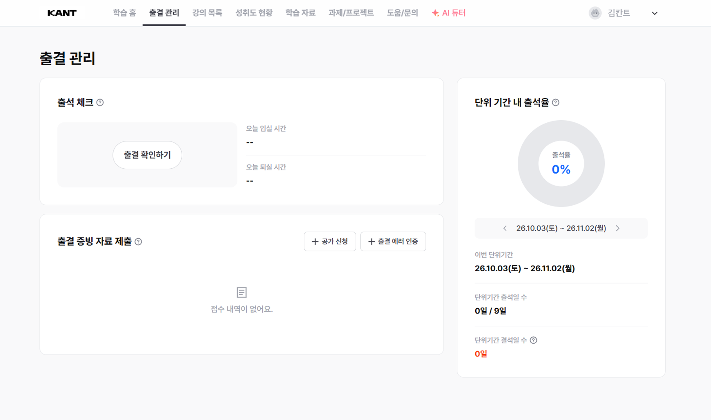
</toggle>

<toggle heading="h2">
③ 성취도 현황

<callout icon="notion://custom_emoji/83c75a39-3aba-4ba4-a792-7aefe4b07895/2e82dc3e-f514-8084-8cc0-007a4092ebbf">
<b>성취도란?</b>

각 트랙의 최종 목표 직무를 달성하기 위해 필수적으로 달성해야 하는 핵심 역량

- 이론: 실무 문제를 올바르게 이해하고 해결하기 위해 필요한 핵심 개념
- 구현: 배운 개념을 실제 문제에 활용할 수 있는 수행 능력

<b>모든 성취도는 목표 직무 취업을 위한 필수 역량입니다.</b>

<b>하나씩 달성하며 취업에 필요한 경쟁력을 완성해 보세요.</b>
</callout>

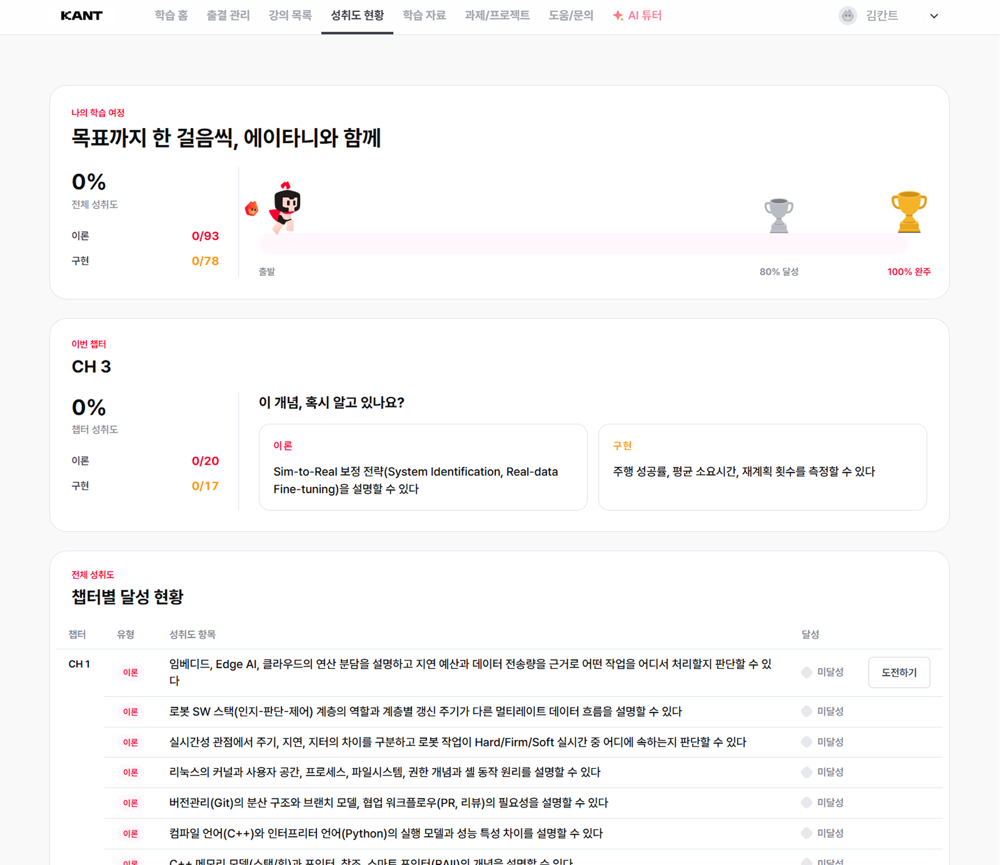

<ul>
<li>
여러분들이 트랙 전체적으로, 혹은 현재 진행중인 챕터 별로 어느 정도 성취도를 달성하고 있는지 확인할 수 있습니다.
</li>
</ul>
</toggle>

<toggle heading="h2">
④ 과제/프로젝트

<callout icon="notion://custom_emoji/83c75a39-3aba-4ba4-a792-7aefe4b07895/2fe2dc3e-f514-8006-95d9-007a99d996b6">
<b>챕터마다 제공된 과제 혹은 프로젝트를 제출하실 수 있는 곳입니다. </b>

<b>구체적인 과제/프로젝트 제출 안내는 추후 안내가 나갈 예정입니다. </b>
</callout>

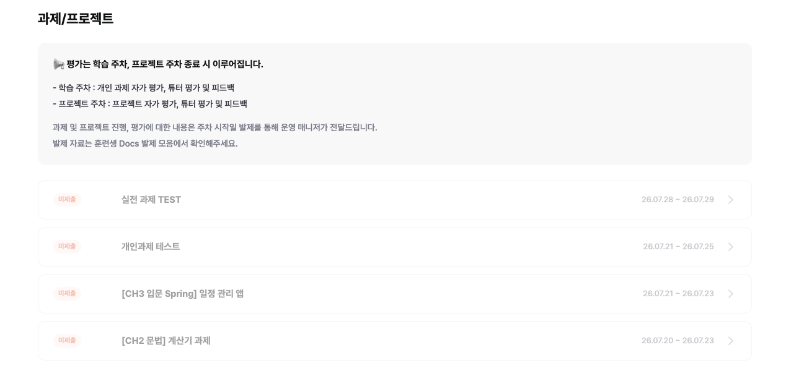

</toggle>

<toggle heading="h2">
⭐️ ⑤ AI 튜터

<callout icon="notion://custom_emoji/83c75a39-3aba-4ba4-a792-7aefe4b07895/31c2dc3e-f514-80ae-a459-007ac4c3f88d">
<b>팀스파르타 내부에서 개발한 에이타니를 활용한 기능들이 모여있는 탭입니다. </b>
</callout>

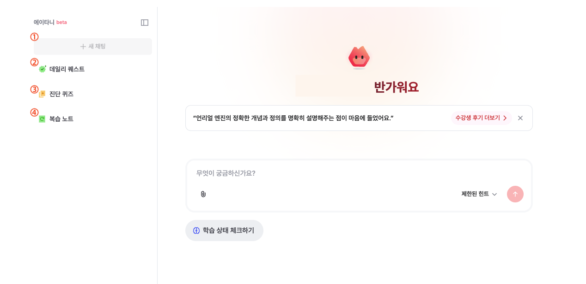

<callout icon="1️⃣">
<b>에이타니 </b>

에이타니는 여러분들의 학습을 도와줄 AI 튜터입니다.

다만 ChatGPT, Claude와 같이 정답을 모두 알려주지는 않으니 공부에 활용하기 좋습니다.

자세한 내용은 에이타니 활용 가이드를 참고해보세요.  (→ [에이타니 활용 가이드로 이동](/3842dc3ef514803d9fc1d47f71a73260?pvs=25))
</callout>

<callout icon="2️⃣">
<b>데일리 퀘스트 </b>

매일 학습한 내용을 체크해볼 수 있는 퀴즈 5문제가 출제됩니다.

오늘 학습이 종료된 후, 퇴실하기 전 꼭 내가 오늘 잘 이해했는지 체크해보세요.

모든 데일리 퀘스트는 제출 내용을 확인하고 복습 하실 수 있습니다.

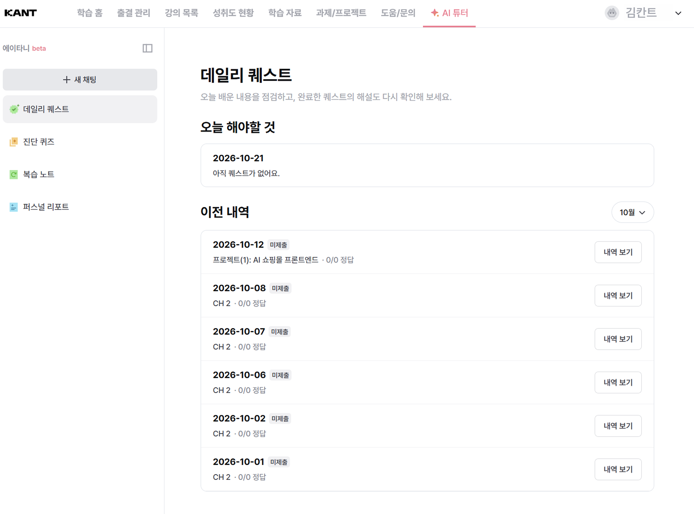
</callout>

<callout icon="3️⃣">

<b>진단 퀴즈</b>

성취도 평가 문항 중 “이론”을 평가할 수 있는 퀴즈입니다.

학습 들으시면서 평가 항목 중 풀 수 있는 항목을 학습했다면  진단 퀴즈를 통해 내가 어느정도로 개념을 이해하고 있는지 성취도를 달성해보시길 바랍니다.

문제는 무한대로 나오지만 그 중 3문제를 꼭 맞춰야 다음 항목으로 넘어갈 수 있으니 참고해 주세요!

<b>⭐️ 성취도를 하나씩 달성할 때마다 내가 성장하고 있다는 느낌을 받으실 겁니다. ⭐️</b>

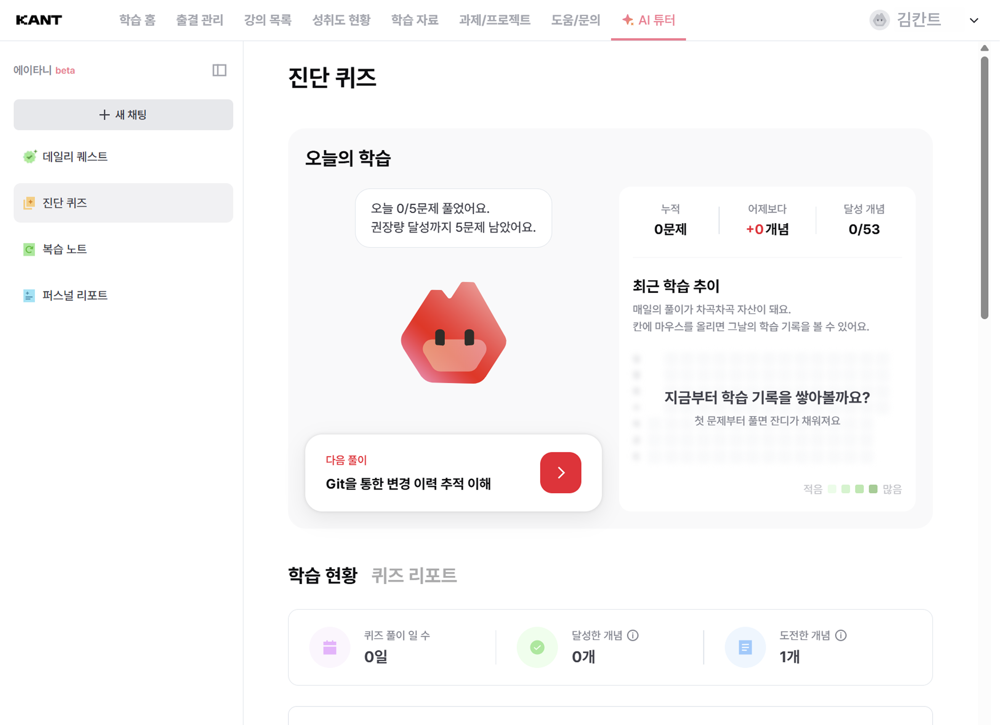

</callout>

<callout icon="4️⃣">

<b>복습 노트</b>

진단 퀴즈에서 틀렸던 문제 혹은 내가 특정 개념에 대해 더 학습하고 싶은 경우,  복습 노트를 활용해주시면 됩니다.

복습 노트에서는 내가 틀렸던 문제를 다시 풀어볼 수도 있고 선택한 항목에 대해 퀴즈를 계속 생성해서 풀어볼 수도 있습니다.

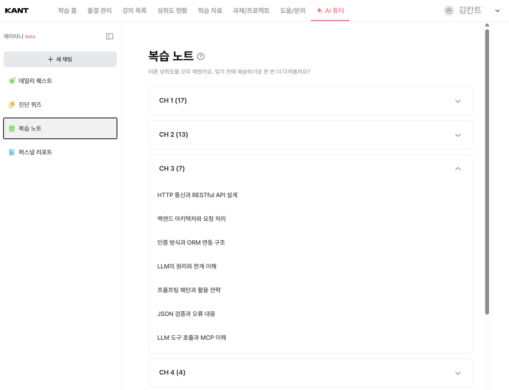
</callout>
</toggle>

<toggle heading="h2">
⑥ 도움/문의

<callout icon="notion://custom_emoji/83c75a39-3aba-4ba4-a792-7aefe4b07895/2e82dc3e-f514-8084-8cc0-007a4092ebbf">
<b>KANT 생활 중 문의나 기기 대여가 필요한 경우 문의 및 신청 하는 곳입니다.</b>

실업 급여, 국취제 증빙 등을 위한 서류를<b> </b>다운 받으실 수 있습니다.

- 수기 출석부 발급
- 훈련 참여 확인서 발급
- 훈련 과정 탐색 결과표

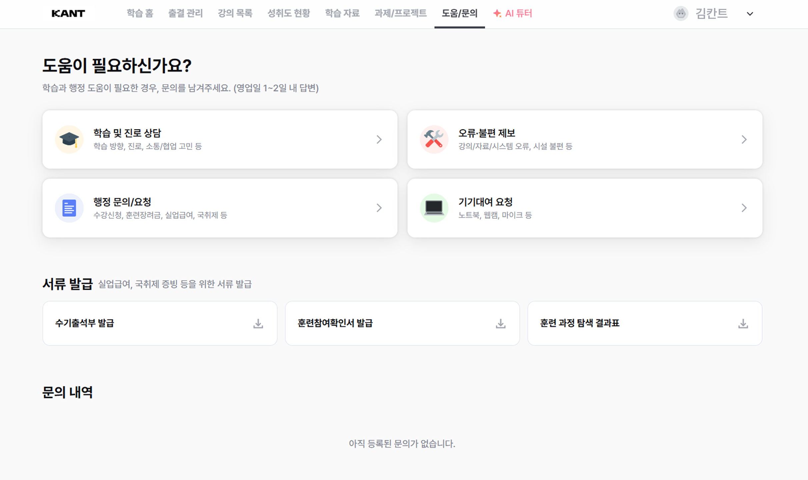
</callout>

- <b>학습 및 진로 상담</b>
- <b>행정 문의/요청</b>
  - 훈련 장려금, 실업 급여, 국취제 등
- <b>오류 불편 제보</b>
  - <b>오프라인 현장 시설 및 비품 부족 문의 방법</b>
    - 오류 불편 제보 클릭
    - 유형 ⇒ 오프라인 현장 시설 및 비품 클릭
    - 내용 ⇒ 상세 문의 내용 작성
- <b>노트북 / 마우스 기기 대여 요청</b>
  - <b>대여 신청 방법</b>
    <ul>
    <li>
    [Notion 연결 페이지](https://app.notion.com/p/39e2dc3ef51480dab0b8eab02c56cfcf)
    </li>
    <li>
    자세한 대여 가이드는 슬랙 좌측[<b> #kant-장비문의 채널</b>](slackChannel://2026kant.slack.com/C0BJKP9DP4M)<b> ⇒ 책갈피 ⇒ </b>[<b>훈련장비 대여 가이드</b>](/p/39e2dc3ef51480dab0b8eab02c56cfcf?pvs=25) 문서 안에서 확인하실 수 있습니다.
    </li>
    <li>
    <b>#kant-장비문의 채널 : </b>[<b>바로가기</b>](slackChannel://2026kant.slack.com/C0BJKP9DP4M)
    </li>
    </ul>
  - <b>대여 기기 사용 중 이슈 문의 방법</b>
    <ul>
    <li>
     책갈피 ⇒ [<b>훈련 장비 문의 접수</b>](https://docs.google.com/forms/d/e/1FAIpQLSfzaRWHRGAeXWT_G3KGPMsGUnH4B_YwknUX8tTdsO3WqK1gAw/viewform) 구글폼으로 제출 해주세요.

    - ex) 고장, 파손, 분실 등
    </li>
    </ul>

  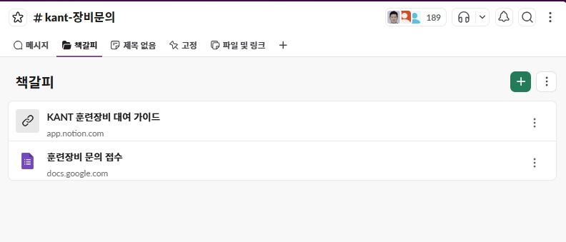
</toggle>

<toggle heading="h2">
⑦ AI 기초 역량 평가

<callout icon="notion://custom_emoji/83c75a39-3aba-4ba4-a792-7aefe4b07895/2e82dc3e-f514-8084-8cc0-007a4092ebbf">
<b>본격적인 교육에 앞서 현재 나의 기초 역량을 확인하는 진단 평가입니다.</b>

평가 결과를 통해 현재 나의 수준을 진단하고, 어떤 역량을 보완해야 하는지 확인할 수 있습니다.

역량 평가는 총 3회차로 이루어져 있으며, 진행 방법은 단계별로 운영진 안내가 나갈 예정입니다.

</callout>
</toggle>
