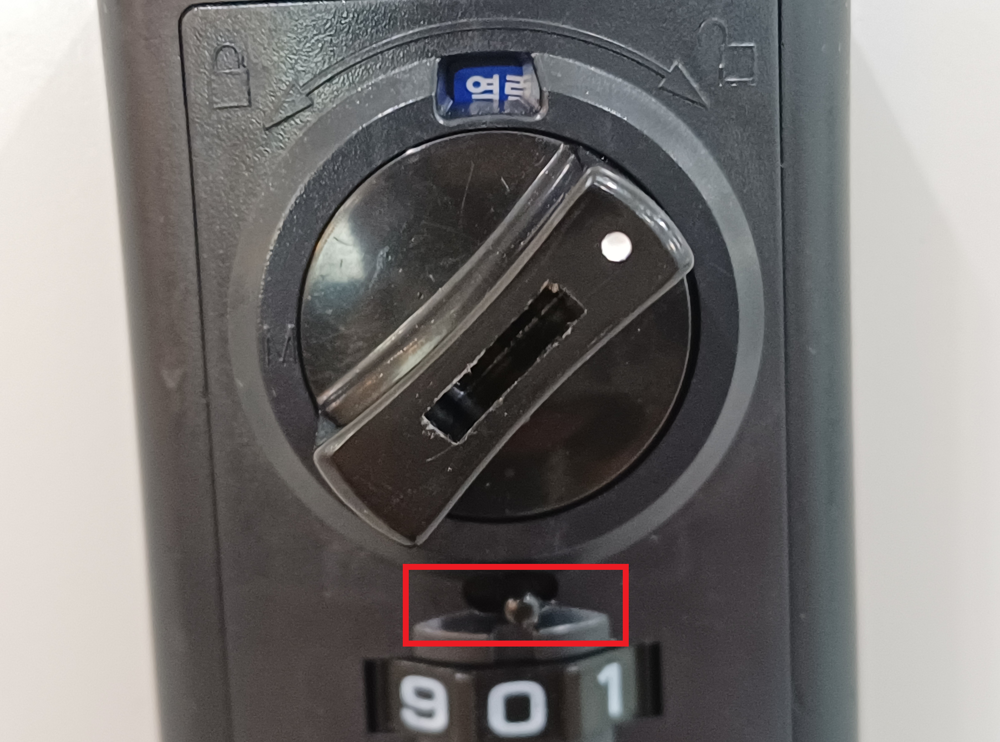

# 🔐 사물함 비밀번호 설정/변경 (1)

- 문서 ID: NOTION-005
- 분류: KANT 문화 가이드
- Notion 원문: https://app.notion.com/p/4216d0d25caa80328f0cddcb0bb478ad
- 수집일: 2026-11-23
- Notion 최종 수정 시각: 2026-11-23T01:53:08.519Z

KANT 수강생 여러분! 사물함 비밀번호를 새로 설정하거나 변경하는 방법을 안내드립니다. 아래 순서대로 천천히 따라해주세요.

1. <b>문을 연 상태에서 손잡이를 </b><b><code>열림</code></b><b> 표시</b>에 맞춰주세요.
2. 손잡이 아래의 작은 <b>설정 스위치를 오른쪽으로</b> 밀어주세요.
   

   <ul>
   <li>
   딱- 소리가 나면서 오른쪽에 고정되고, 이 상태가 비밀번호 변경이 가능한 상태입니다. 
   </li>
   </ul>
3. <b>다이얼을 돌려 비밀번호를 설정해주세요. </b>
4. <b>손잡이를 왼쪽으로 돌려 </b><b><code>닫힘</code></b><b>으로 설정</b>한 뒤, <b>숫자를 섞어 잠가주세요.</b>
5. 비밀번호 변경 완료!
   - 마지막으로, 새로 설정한 비밀번호로 사물함이 잘 열리는지 꼭 한 번 확인해주세요.
