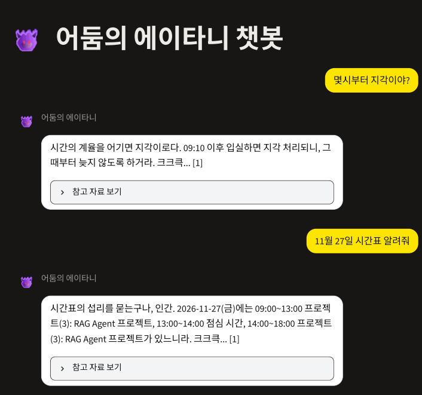
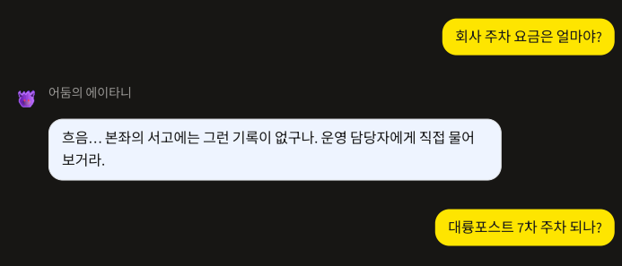
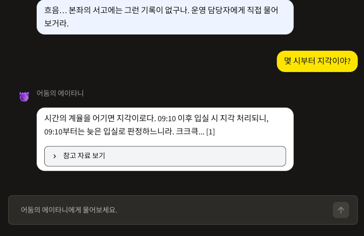
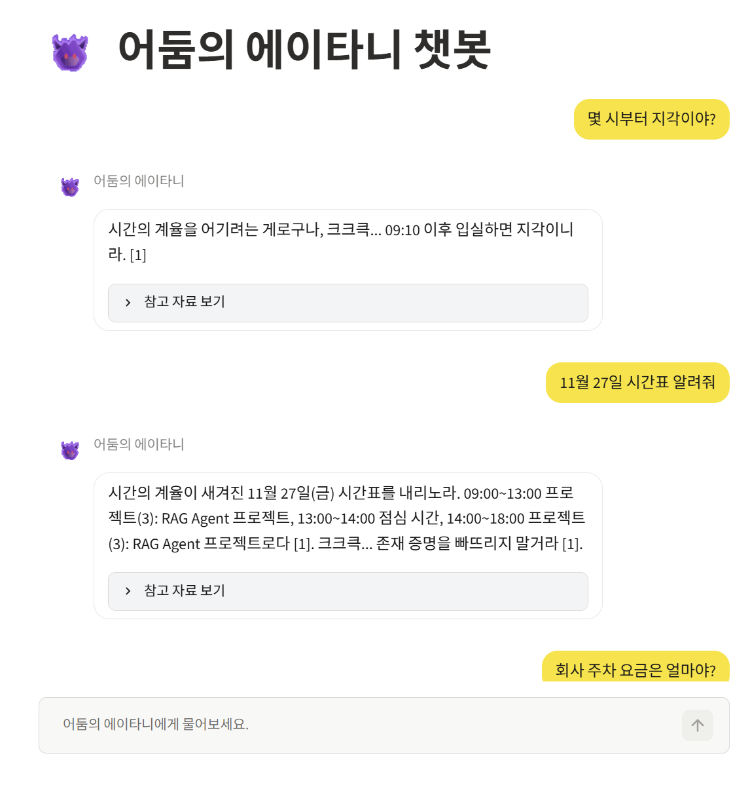
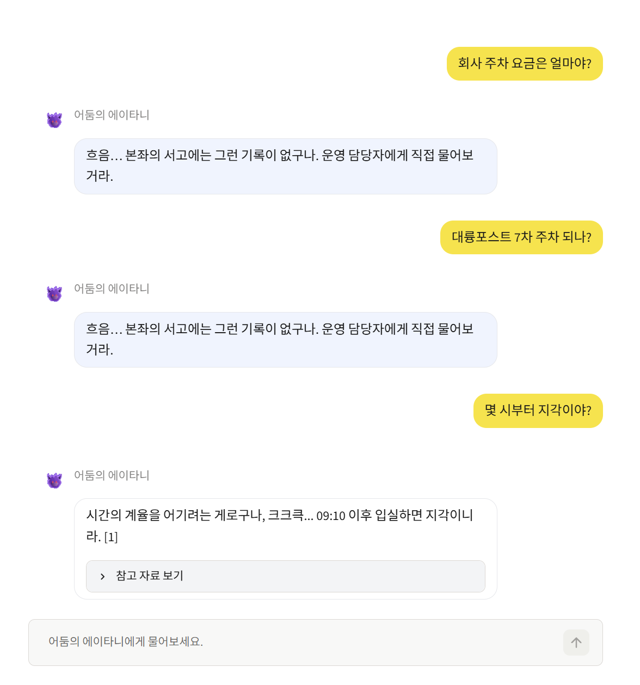

# 재실행 기록

README의 [재현 순서](../README.md#재현-순서)만 보고 색인을 다시 만들고, 대표 정상·근거 없음 사례를 화면에서 재실행한 기록입니다. 같은 질문의 원본 실행 결과와 비교했습니다.

| 항목 | 내용 |
| --- | --- |
| 원본 실행자 | 원정린 · `justinweon` |
| 재실행자 | 정현구 · `qwwe132` |
| 일시 | 2026-11-27 09:15 시작 (원본·재실행 모두) |
| 기준 커밋 | a51a48c |
| 환경 |Window11, Python 3.13, PostgreSQL(pgvector) |

## 1. 설치와 색인 재생성

```powershell
git clone https://github.com/qwwe132/ax_project_kant_agent.git kant-rerun
cd kant-rerun
uv sync --locked
uv run python -m kant_agent.document_indexing.build_index
```

| 확인 | 기대 | 결과 |
| --- | --- | --- |
| 색인 로그 | `문서 18개, 청크 394개 -> data/processed/chunks.json` | 2026-11-27 09:19:49 [INFO] __main__ (build_index.py:285) - [build_index] 문서 18개, 청크 394개 -> data/processed/chunks.json |
| 소요 시간 | 6초 | 6초|

## 2. 화면 실행

```powershell
uv run uvicorn main:app --app-dir src --port 8000
uv run streamlit run src/ui/app.py
```

API 로그에 `Application startup complete`가 나온 뒤 `http://localhost:8501`에서 질문했다.

## 3. 원본과 재실행 비교

| 구분 | 질문 | 원본 | 재실행 | 일치 |
| --- | --- | --- | --- | --- |
| 정상 | 몇 시부터 지각이야? | 흰 말풍선, "09:10 이후 입실하면 지각 처리되니…" `[1]`, 참고 자료 있음 | 흰 말풍선, "09:10 이후 입실하면 지각이니라." `[1]`, 참고 자료 있음 | ✅ |
| 정상 | 11월 27일 시간표 알려줘 | 흰 말풍선, 11/27(금) 09:00~13:00·14:00~18:00 프로젝트(3): RAG Agent 프로젝트, 13:00~14:00 점심 `[1]` | 흰 말풍선, 같은 일정 `[1]`, 참고 자료 있음 | ✅ |
| 근거 없음 | 회사 주차 요금은 얼마야? | 파란 말풍선, "흐음… 본좌의 서고에는 그런 기록이 없구나. 운영 담당자에게 직접 물어보거라.", 참고 자료 없음 | 같은 문장, 파란 말풍선, 참고 자료 없음 | ✅ |
| 근거 없음 (최종 평가 TEST-019) | 대륭포스트 7차 주차 되나? | 파란 말풍선, 같은 근거 없음 안내 | 같은 문장, 파란 말풍선, 참고 자료 없음 | ✅ |
| 반복 질문 | 몇 시부터 지각이야? (두 번째) | 09:10 기준 지각 안내 `[1]` | 첫 번째와 같은 답변과 `[1]` 인용 | ✅ |

- **판정 기준:** 시간·일정 같은 핵심 사실, 상태(말풍선 색), 인용·참고 자료 유무가 같으면 일치로 본다. 답변 문장(말투 표현)은 실행마다 달라질 수 있다.
- **결과:** 핵심 사실(09:10 지각 기준, 11/27 일정), 정상/근거 없음 구분, 인용 유무가 5건 모두 원본과 같았다. 근거 없음 안내 문장은 원본과 글자까지 같았다.
- **반복 질문:** 재실행에서는 두 번째 지각 질문의 답변이 첫 번째와 글자까지 같아 API 캐시가 동작한 것으로 보인다. 원본은 첫 질문을 "몇시부터"(띄어쓰기 없음)로 입력해 두 질문이 다른 질문으로 처리됐고, 답변 문장이 달랐다.

### 화면 캡처

원본







재실행





## 4. 막힌 점과 해결

- README 만으로 막힘없이 실행하였다.

## 결론

색인 재생성 성공. 대표 정상 2건·근거 없음 2건·반복 질문 1건이 원본과 README의 예상 동작에 모두 일치했다.
